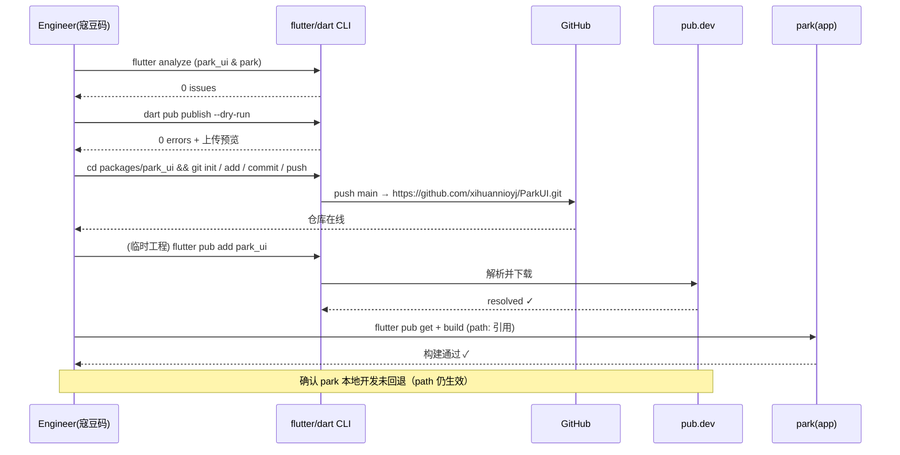

# ParkUI（`park_ui`）发布架构设计 + 任务分解

> 作者：高见远（Architect） · 团队：`software-parkui-publish`
> 目标：将 `park_ui`（71 组件 / 6 分类 / Stripe 风格）从私有 `path:` 依赖转为 **pub.dev 公开发布** v1
> 输出语言：中文 · 结构：表格 / Mermaid / 代码块

---

## 0. 关键决策（已锁定 / 已核实）

### 0.1 已锁定用户决策（禁止复议）

| # | 决策项 | 值 |
|---|--------|-----|
| 1 | 分发渠道 | **public pub.dev**（`flutter pub add park_ui`） |
| 2 | 许可证 | **MIT** |
| 3 | 代码仓库 | **独立仓库**，remote = `https://github.com/xihuannioyj/ParkUI.git`；`park` 应用继续用 `path:` 本地开发（**不得破坏**） |
| 4 | v1 范围 | 先完成 app 端 **71 组件展示**，再发布 |

### 0.2 已核实事实（本次读取确认）

| 事实 | 值 / 路径 | 备注 |
|------|-----------|------|
| `park` 是 git 仓库（顶层 `D:/project/javasup/park`） | ✅ | `packages/park_ui/` 当前**被父仓库跟踪** |
| `packages/park_ui/_scan2.py` 存在 | ✅ 2604 B | **必须删除**（垃圾脚本） |
| `packages/park_ui/lib/park_upload.dart.__tmp__` | 已不存在 | 无需处理 |
| `packages/park_ui/example/` | 不存在 | **必须创建** |
| `packages/park_ui/build/` | 存在 | pub.dev 自动忽略；`.pubignore` 仍建议写 |
| `park_ui` 依赖 | 仅 `flutter` + `equatable`，**无本地 path 依赖** | 安全可独立发布 |
| 条件导入 | 使用 `io/html` 做 web/native 分支 | 不改 |
| `park_ui/pubspec.yaml` 现状 | `publish_to: 'none'` / `resolution: workspace` / `description` 写 "56" / `sdk: ^3.11.5` | 需修正 |
| `park/pubspec.yaml` | **含 `workspace: - packages/park_ui`** + `park_ui: path: packages/park_ui` | 关键：见 §0.3 / Open Q1 |
| 安装环境 Dart | **3.12.2 (stable)** / Flutter 3.44.4 | `^3.11.5` 满足（≥3.11.5） |

### 0.3 四个开放问题的**最终决议**（由 Architect 拍板）

**Q1 — 仓库拓扑（嵌套 git + 父 .gitignore）**
- ✅ `park_ui` 物理位置**保持** `packages/park_ui/`，作为其**自有嵌套 git 仓库**。
- ✅ `park` 根 `.gitignore` 追加一行 `packages/park_ui/`。
- ✅ **保留** `park/pubspec.yaml` 的 `workspace: - packages/park_ui` 字段（它**不阻断** `park_ui` 独立发布；`park_ui` 移除 `resolution: workspace` 才是关键）。
- ✅ **移除** `park_ui/pubspec.yaml` 的 `resolution: workspace`。移除后 `park` 通过 `path:` 引用 `park_ui` 仍正常（path 依赖与 `resolution: workspace` 正交）。
- 精确命令见 §5 Task Group B（B1-1 / B1-2）。

**Q2 — example 结构**
- `example/pubspec.yaml` 用 `park_ui: path: ..`（相对路径）。pub.dev **支持** example 内的 `path` 依赖，`dart pub publish` 只校验根包、`example/` 不会被当作独立包发布。
- **默认不写** `dependency_overrides`；仅当 `flutter pub get` 在 example 内报版本冲突时，再加 `dependency_overrides: park_ui: path: ..`。
- 单入口示例 app（`example/lib/main.dart`）即可。

**Q3 — SDK 约束**
- 当前 `sdk: ^3.11.5` → 等价于 `>=3.11.5 <4.0.0`，**已满足 pub.dev 开放上界要求**；本机 3.12.2 满足下界。
- 决议：**保留 `^3.11.5`**，不改。（如需更"贴身"可改为 `^3.12.0`，但 `^3.11.5` 包容性更好、零风险。）

**Q4 — workspace 残留**
- 移除 `park_ui` 的 `resolution: workspace` 后，`park` 自身的依赖解析**不受影响**（其用 `path:` + 根 `workspace:` 字段，与 `park_ui` 是否声明 `resolution` 无关）。
- 两份 pubspec 均已读取核对（见 0.2）。

---

## 1. 实现方案 + 框架选型

### 1.1 发布方式（`dart pub publish` 流程）

采用 **Dart 官方发布流**，无额外 CI 框架：

1. 本地清单修正（P0）→ `flutter analyze`（park_ui 与 park 均 0 issue）→ `dart pub publish --dry-run`（0 error，产出上传预览）。
2. 初始化嵌套 git 仓库并推送到 GitHub（P1）。
3. 在临时工程验证 `flutter pub add park_ui` 可解析（联网走 pub.dev）。
4. 确认 `park` 仍经 `path:` 构建通过（本地开发不回退）。
5. **实际 `dart pub publish` 是否 live 执行** → 见 §8 待明确事项（建议先停在 `--dry-run`，待 Lead 签字后再 live）。

### 1.2 example 方案

- 新建 `example/`，提供**单入口 MaterialApp**，展示 3–5 个代表性组件（ParkButton / ParkInput / ParkCard / ParkAvatar / ParkTag），并注入 `ParkThemeData.light()/.dark()` 主题。
- P1 阶段再"丰富 example"：按 6 分类加 tab 页，使其 `flutter run` 可见多组件（复用 `park_ui_demo_page` 思路但独立、精简，不依赖 `park` 的 GetX）。

### 1.3 文档策略（`///` doc pass）

- 范围：`park_ui.dart` 导出的**全部公开类 / 枚举 / 主要属性**（详见 §3）。
- 风格：对齐现有 `park_input.dart` —— 每个公开类一句 `///` 概述 + 至少一个 ```dart 可运行示例块；每个公开属性一句 `///`；枚举值逐条 `///`。
- 非 P0 阻断，但为 pre-v1 必需（P1-B1-3）。

### 1.4 选型表

| 维度 | 选型 | 理由 |
|------|------|------|
| 包管理 | `dart pub publish` + pub.dev | 锁定决策 |
| 主题 | 现有 `ParkThemeData` / 设计令牌 | 已成熟，不重构 |
| 条件导入 | `dart:io` / `dart:html` | 已存在，web/native 分支保留 |
| 示例依赖 | `path: ..` | pub.dev 支持，零新增依赖 |
| 仓库 | 嵌套 git（独立 remote） | 锁定决策 |
| Lint | `flutter_lints: ^6.0.0`（沿用） | 不新增 |

---

## 2. 文件列表及相对路径

> 所有路径**相对** `packages/park_ui/`，除非标注 `(park 根)`。

### 2.1 新建 / 修改清单

| 操作 | 相对路径 | 说明 | 阶段 |
|------|----------|------|------|
| 删除 | `_scan2.py` | 垃圾脚本 | P0 |
| 新建 | `LICENSE` | MIT 全文 | P0 |
| 新建 | `README.md` | 安装 / 快速开始 / 6 分类 | P0 |
| 新建 | `CHANGELOG.md` | `## 0.1.0` 条目 | P0 |
| 新建 | `.pubignore` | 排除 build/工具/垃圾 | P0 |
| 修改 | `pubspec.yaml` | 见 §2.2 精确改行 | P0 |
| 新建 | `example/pubspec.yaml` | `path: ..` 依赖 | P0 |
| 新建 | `example/lib/main.dart` | 3–5 组件展示 | P0 |
| 新建 | `example/analysis_options.yaml` | 复用 lint（可选） | P0 |
| 新建 | `.gitignore` | 嵌套仓库忽略 build/.dart_tool | P1 |
| 修改 | `(park 根) .gitignore` | 追加 `packages/park_ui/` | P1 |
| 修改 | `lib/**`（105 个导出文件内的公开 API） | `///` 文档补全 | P1 |
| 修改 | `example/lib/main.dart`（增强） | 6 分类 tab 示例 | P1 |
| 修改 | `(park 根) lib/src/pages/core/park_ui_demo_page.dart` | 71 组件展示补全 | P2 |

### 2.2 `pubspec.yaml` 精确改行（工程师逐行照做）

当前文件（19 行）：
```yaml
1  name: park_ui
2  description: Park UI - 独立、可插拔的 Flutter UI 组件集。参考 TDesign 设计语言，提供 56 个自定义控件和完整的设计令牌系统。
3  version: 0.1.0
4  publish_to: 'none'
5
6  resolution: workspace
7
8  environment:
9    sdk: ^3.11.5
10
11 dependencies:
12   flutter:
13     sdk: flutter
14   equatable: ^2.0.7
15
16 dev_dependencies:
17   flutter_test:
18     sdk: flutter
19   flutter_lints: ^6.0.0
```

**改动清单**：
| 行 | 动作 | 内容 |
|----|------|------|
| 2 | 改 | `description:` 中 `56` → `71`；移除具体设计语言名（"TDesign" 与 PRD "Stripe" 冲突，见 §8）→ 中性表述 |
| 4 | **删** | 整行 `publish_to: 'none'`（移除后默认发布 pub.dev） |
| 6 | **删** | 整行 `resolution: workspace`（及其上下空行） |
| 9 | 保留 | `sdk: ^3.11.5`（已合规） |
| — | **新增** | `repository:` / `homepage:` / `issue_tracker:`（置于 `version` 之后） |

**改后完整文件（直接覆盖）**：
```yaml
name: park_ui
description: Park UI - 独立、可插拔的 Flutter UI 组件集。提供 71 个自定义控件和完整的设计令牌系统，覆盖基础/输入/导航/展示/反馈/表单六大类。
version: 0.1.0
# publish_to 已移除 → 默认发布到 pub.dev

environment:
  sdk: ^3.11.5

dependencies:
  flutter:
    sdk: flutter
  equatable: ^2.0.7

dev_dependencies:
  flutter_test:
    sdk: flutter
  flutter_lints: ^6.0.0

# 仓库元信息（发布必填，指向 GitHub）
repository: https://github.com/xihuannioyj/ParkUI.git
homepage: https://github.com/xihuannioyj/ParkUI
issue_tracker: https://github.com/xihuannioyj/ParkUI/issues
```

> ⚠️ `version: 0.1.0`：v1 首发的**对外版本号**是否用 `1.0.0` 见 §8。锁定的 PRD 当前为 `0.1.0`，本设计沿用；若 Lead 决定首发即 `1.0.0`，仅改此一行 + CHANGELOG 标题。

---

## 3. 包公共 API 面映射（替代类图）

> 发布任务无运行时类关系图；此处给出 `park_ui.dart` 导出的**公开 API 面**，作为 `///` 文档补全（B1-3）与展示补全（P2）的**权威范围**。

### 3.1 六大分类 + 支撑模块导出总览

| 模块 | 目录 | 导出文件数 | 公开组件/类（catalog 口径） |
|------|------|-----------|------------------------------|
| 主题/令牌 | `src/theme` | 8 | `ParkTheme`, `ParkThemeData`, `ParkColors`, `ParkTypography`, `ParkSpacing`, `ParkRadius`, `ParkShadows`, `ParkMotion` |
| **基础** | `src/components/base` | 7 | `ParkButton`, `ParkButtonStyle`, `ParkText`, `ParkIcon`, `ParkDivider`, `ParkFab`, `ParkLink`（catalog 计 6 个组件） |
| **输入** | `src/components/input` | 21 | `ParkInput`/`ParkTextarea`/`ParkSearch`/`ParkSwitch`/`ParkCheckbox`/`ParkRadio`/`ParkSelect`/`ParkDatePicker`/`ParkPicker`/`ParkCascader`/`ParkTreeSelect`/`ParkSlider`/`ParkStepper`/`ParkRate`/`ParkUpload`/`ParkForm`/`ParkFormItem`/`ParkFormSection`/`ParkSegmented`/`ParkInputGroup`/`ParkCalendar`（catalog 计 19） |
| **导航** | `src/components/navigation` | 10 | `ParkTabs`/`ParkTabBar`/`ParkNavBar`/`ParkSideBar`/`ParkSteps`/`ParkDrawer`/`ParkBackTop`/`ParkIndexes`/`ParkBreadcrumb`/`ParkPagination`（catalog 计 10） |
| **展示** | `src/components/display` | 23 | `ParkAvatar`/`ParkBadge`/`ParkCell`/`ParkDescriptions`/`ParkTag`/`ParkCollapse`/`ParkEmpty`/`ParkImage`/`ParkImageViewer`/`ParkProgress`/`ParkResult`/`ParkSkeleton`/`ParkSwiper`/`ParkTable`/`ParkCounter`/`ParkFooter`/`ParkGrid`/`ParkList`/`ParkEllipsis`/`ParkTimeline`/`ParkTooltip`/`ParkSticky`/`ParkCard`（catalog 计 23） |
| **反馈** | `src/components/feedback` | 12 | `ParkDialog`/`ParkToast`/`ParkLoading`/`ParkActionSheet`/`ParkPopup`/`ParkDropdownMenu`/`ParkNoticeBar`/`ParkMessage`/`ParkPopover`/`ParkRefresh`/`ParkSwipeCell`/`ParkOverlay`（catalog 计 12） |
| **动态表单** | `src/form` | 18 | models(4)+engine(5)+validators(4)+regex(1)+data_source(1)+widgets(3)+platform(1)；**展示组件**仅 `ParkDynamicForm` |
| **双向绑定** | `src/binding` | 6 | `ParkBindable`/`ParkBindingService`/`ParkBindingPath`/`ParkBindingFormFieldMixin`/`ParkBindingFormScope`/`ParkBindingMixin`；**展示组件**仅 `ParkBinding` |

> 导出文件总计 = 8+7+21+10+23+12+18+6 = **105** 个文件。`///` 文档补全覆盖这 105 个文件内的全部公开类/枚举/属性。

### 3.2 六大组件分类计数（来自 `ComponentCatalog.categories`，展示补全范围）

| 分类（_Cat.id） | 组件数 | 对应 demo 类（行号，已存在骨架） |
|------------------|--------|-----------------------------------|
| 基础 base | 6 | `_BaseDemos` (L1491) |
| 输入 input | 19 | `_InputDemos` (L1665) |
| 导航 nav | 10 | `_NavDemos` (L2231) |
| 展示 display | 23 | `_DisplayDemos` (L2538) |
| 反馈 feedback | 12 | `_FeedbackDemos` (L3088) |
| 表单 form | 2（`ParkDynamicForm`+`ParkBinding`） | `_FormDemos` (L612) |
| **合计** | **72**（catalog 实际列 72 项；锁定口径为 **71**，见 §8） | — |

---

## 4. 发布验证流程（替代时序图）

### 4.1 验证流程序列图（Mermaid）



### 4.2 验证命令清单（DoD 核对）

```bash
# 1) 静态分析（park_ui 与 park 均须 0 issue）
cd packages/park_ui && flutter analyze
cd ../../ && flutter analyze

# 2) 发布预检（0 error）
cd packages/park_ui && dart pub publish --dry-run

# 3) example 可构建
cd packages/park_ui/example && flutter pub get && flutter analyze

# 4) park 经 path 仍构建
cd ../../../ && flutter pub get
```

> DoD 全量：① `dart pub publish --dry-run` = 0 error；② `flutter analyze` 在 park_ui 与 park 均 clean；③ example 可构建；④ 仓库已 push；⑤ `flutter pub add park_ui` 可解析；⑥ `park` 仍经 path 构建通过。

---

## 5. 任务列表（有序 / 依赖 / 实现顺序）

> 三组：**A = P0（发布阻断项）** → **B = P1（仓库 + 文档）** → **C = P2（71 组件展示）** → **Live 发布**（待 §8 签字）。
> 依赖原则：A 全完成才能 dry-run=0；B 的 git 推送依赖 A 已删 `_scan2.py` 与已建 `example/`；C 与 B 的 doc 可并行，但按锁定决策 C 须在 **live 发布前**完成。

### Task Group A — P0（Phase 0：发布阻断项，必须全过）

**A1 · 删除垃圾脚本**
- 文件：`packages/park_ui/_scan2.py`（删除）
- 命令（PowerShell）：`Remove-Item packages/park_ui/_scan2.py`
- 校验：`Test-Path packages/park_ui/_scan2.py` 返回 False

**A2 · 创建 `LICENSE`（MIT）**
- 新建 `packages/park_ui/LICENSE`，标准 MIT 全文，`Copyright (c) 2026 xihuannioyj`。
```text
MIT License

Copyright (c) 2026 xihuannioyj

Permission is hereby granted, free of charge, to any person obtaining a copy
of this software and associated documentation files (the "Software"), to deal
in the Software without restriction... (完整 MIT 标准文本)
```

**A3 · 创建 `README.md`**
- 新建 `packages/park_ui/README.md`：标题 + 徽章 + 特性（71 组件 / 6 分类 / 设计令牌 / 动态表单 / 双向绑定）+ 安装（`flutter pub add park_ui`）+ 快速开始（复用 `park_ui.dart` 顶部 library doc 示例）+ 6 大分类清单 + License 段。

**A4 · 创建 `CHANGELOG.md`**
- 新建 `packages/park_ui/CHANGELOG.md`，遵循 pub 约定：
```markdown
## 0.1.0
- 初始发布：71 个自定义控件，覆盖基础/输入/导航/展示/反馈/表单六大类。
- 完整设计令牌系统（颜色/字体/间距/圆角/阴影/动效）。
- 动态表单引擎（schema 驱动 + 联动反应 + 校验/异步校验 + 格式化）。
- 双向绑定基座（路径绑定 + FormField mixin）。
```

**A5 · 创建 `.pubignore`**
- 新建 `packages/park_ui/.pubignore`：
```text
# 构建产物 / 工具目录（pub 默认已忽略 build/ 与 .dart_tool/，此处显式兜底）
build/
.dart_tool/
.doc/
.idea/

# 垃圾 / 临时文件
*.tmp
*.__tmp__
_scan*.py

# 本地分析配置（如需独立 lint 规则可删此行）
analysis_options.yaml
```
> 注意：**不要**忽略 `example/`（pub 需要把 example 纳入发布预览）。

**A6 · 修改 `pubspec.yaml`**
- 按 §2.2 精确改行（删 `publish_to`、删 `resolution: workspace`、`56`→`71`、新增 repository/homepage/issue_tracker）。覆盖为 §2.2 给出的完整内容。

**A7 · 创建 `example/`**
- `example/pubspec.yaml`：
```yaml
name: park_ui_example
description: Demonstrates the park_ui Flutter component library.
publish_to: 'none'

environment:
  sdk: ^3.11.5

dependencies:
  flutter:
    sdk: flutter
  park_ui:
    path: ..

dev_dependencies:
  flutter_test:
    sdk: flutter
  flutter_lints: ^6.0.0
```
- `example/lib/main.dart`：MaterialApp + `ParkThemeData.light()/.dark()` + 展示 `ParkButton` / `ParkInput` / `ParkCard` / `ParkAvatar` / `ParkTag`（约 3–5 个组件，简单纵向排列即可）。
- `example/analysis_options.yaml`（可选）：含 `include: package:flutter_lints/flutter.yaml`。

**A 组完成标志**：`dart pub publish --dry-run` = 0 error（此时尚未 push，仅本地校验）。

---

### Task Group B — P1（仓库 + 文档，预发布必需）

**B1 · 初始化嵌套 git 仓库并推送**
- 前置：A1（已删 `_scan2.py`）、A5/A7 已完成。
- 先新建 `packages/park_ui/.gitignore`（嵌套仓库忽略项）：
```text
.dart_tool/
build/
doc/api/
.idea/
*.tmp
*.__tmp__
```
- 执行（PowerShell，注意在 `packages/park_ui` 内）：
```powershell
cd packages/park_ui
git init
git remote add origin https://github.com/xihuannioyj/ParkUI.git
git add .
git commit -m "chore: init park_ui v0.1.0 — publish to pub.dev"
git branch -M main
git push -u origin main
```
- ⚠️ `git add .` 前务必确认 `_scan2.py` 不在、`build/` 被 `.gitignore` 忽略（用 `git status` 抽查）。

**B2 · 父仓库 `.gitignore` + 解绑跟踪**
- 编辑 `D:/project/javasup/park/.gitignore`，**追加一行**：
```text
packages/park_ui/
```
- 在 `park` 根执行，将 `park_ui/` 从父仓库索引移除（**不删文件**）：
```powershell
cd D:/project/javasup/park
git rm -r --cached packages/park_ui
git commit -m "chore: detach park_ui into its own nested git repo"
```
- 效果：`park` 不再跟踪 `packages/park_ui/**`；`park` 经 `path: packages/park_ui` 引用仍正常（目录在本地存在）。

**B3 · `///` 文档补全（公开 API）**
- 范围：§3.1 所列 **105 个导出文件**内的全部公开类 / 枚举 / 主要属性。
- 规范（对齐 `park_input.dart`）：
  - 每个公开类：一句 `///` 概述 + 至少一个 ```dart 可运行示例块。
  - 每个公开属性：一句 `///` 说明（避免"魔法"缩写，写清语义）。
  - 每个枚举值：逐条 `///`（如 `ParkInputStatus.error` → `/// 错误状态 — 红色边框`）。
- 优先级：先 6 大组件分类（base/input/nav/display/feedback/form 的 widget 文件），再 theme 令牌、binding。
- 工具辅助：可用 `dart doc` 抽查是否所有 public 元素都有 doc（CI 可选）。

**B4 · 丰富 example**
- 在 `example/lib/main.dart` 基础上，按 6 分类加 `TabBar`/分类页，使其 `flutter run` 可见多组件（**不依赖 `park` 的 GetX**；纯 `park_ui` + `flutter`）。
- 目标：example 既能被 `flutter analyze` 通过，也能作为对外"活文档"。

**B 组完成标志**：GitHub 仓库在线；`park` 父仓库提交解绑；`///` 覆盖全部公开 API；example 可运行。

---

### Task Group C — P2（71 组件展示补全，最大块）

> 在既有 `park/lib/src/pages/core/park_ui_demo_page.dart` 的 6 个 `_XxxDemos` 骨架类内补全。**只给计划与顺序，不给具体代码**（工程师执行）。
> 每个组件 demo 的**统一要求**：
> 1. **功能 demo**：覆盖主要 variant / 状态切换（如 ParkButton 的 primary/secondary/outline/danger + disabled）。
> 2. **属性文档**：经 `park_component_detail_page`（`lib/src/pages/park/`）展示属性表；中文名取自 `component_zh_names.dart` 的 `kComponentZhNames`。
> 3. **去魔法值**：删除 `_lBrand`/`_lBg`/`_dBrand` 等硬编码色板，**改用 `ParkColors` 设计令牌**（如 `ParkColors.brand`）。
> 4. **对标**：与 **Ant Design NG / TDesign** 记录差异点（命名、默认值、交互），写入组件 demo 顶部注释或 detail 页。
> 5. **7 批次打磨**：按分类分 6 批 + 1 批全局收尾（暗色模式一致性 / 间距令牌 / 无障碍语义）。

**C1 · 基础（6）— `_BaseDemos` (L1491)**
`ParkButton` / `ParkText` / `ParkIcon` / `ParkDivider` / `ParkFab` / `ParkLink`

**C2 · 输入（19）— `_InputDemos` (L1665)**
`ParkInput` / `ParkTextarea` / `ParkSearch` / `ParkSwitch` / `ParkCheckbox` / `ParkRadio` / `ParkSelect` / `ParkDatePicker` / `ParkPicker` / `ParkCascader` / `ParkTreeSelect` / `ParkSlider` / `ParkStepper` / `ParkRate` / `ParkUpload` / `ParkForm` / `ParkSegmented` / `ParkCalendar` / `ParkInputGroup`

**C3 · 导航（10）— `_NavDemos` (L2231)**
`ParkTabs` / `ParkTabBar` / `ParkNavBar` / `ParkSideBar` / `ParkSteps` / `ParkDrawer` / `ParkBackTop` / `ParkIndexes` / `ParkBreadcrumb` / `ParkPagination`

**C4 · 展示（23）— `_DisplayDemos` (L2538)**
`ParkAvatar` / `ParkBadge` / `ParkCell` / `ParkDescriptions` / `ParkTag` / `ParkCollapse` / `ParkEmpty` / `ParkImage` / `ParkImageViewer` / `ParkProgress` / `ParkResult` / `ParkSkeleton` / `ParkSwiper` / `ParkTable` / `ParkCounter` / `ParkFooter` / `ParkGrid` / `ParkList` / `ParkEllipsis` / `ParkTimeline` / `ParkTooltip` / `ParkSticky` / `ParkCard`

**C5 · 反馈（12）— `_FeedbackDemos` (L3088)**
`ParkDialog` / `ParkToast` / `ParkLoading` / `ParkActionSheet` / `ParkPopup` / `ParkDropdownMenu` / `ParkNoticeBar` / `ParkMessage` / `ParkPopover` / `ParkRefresh` / `ParkSwipeCell` / `ParkOverlay`

**C6 · 表单（2 + 引擎）— `_FormDemos` (L612)**
`ParkDynamicForm` / `ParkBinding`（展示组件）；底层引擎/校验/绑定经由 `ParkDynamicForm` 的 schema 示例体现（异步校验、联动反应、格式化）。

**C 组顺序依赖**：C1→C2→C3→C4→C5→C6（按分类递进；每批内先去魔法值，再补功能 demo，再补属性文档，最后写对标注释）。C 必须在 **live 发布前**完成（锁定决策 #4）。

---

### 5.4 任务依赖总图（Mermaid）

```mermaid
graph TD
    A[A: P0 发布阻断项<br/>删_scan2 / LICENSE / README / CHANGELOG<br/>.pubignore / pubspec / example]
    B[B: P1 仓库+文档<br/>git init+push / 父.gitignore<br/>/// doc / 丰富example]
    C[C: P2 71组件展示<br/>6分类补全+去魔法+对标]
    PUB[[Live: dart pub publish<br/>(待 §8 签字)]]

    A --> B
    A --> C
    B --> PUB
    C --> PUB
    B -.->|B3 /// doc 可与 C 并行| C
```
> 说明：A 是 B、C 的前置；B 与 C 可部分并行（B3 文档与 C 展示可同步推进），但二者都完成后才做 Live 发布。

---

## 6. 依赖包列表

> **无需新增任何第三方包。**

| 包 | 用途 | 现状 |
|----|------|------|
| `flutter` (sdk) | UI 框架 | 已存在（park_ui + example） |
| `equatable` ^2.0.7 | 值相等 | 已存在（park_ui） |
| `flutter_test` / `flutter_lints` ^6.0.0 | 测试 / lint | 已存在（dev） |
| `park_ui: path: ..` | example 引用本体 | 新建 example 时引入（path，非新增包） |

---

## 7. 共享知识（跨文件约定）

- **命名约定**：公开组件统一 `Park` 前缀（如 `ParkButton`）；样式类 `ParkXxxStyle`；枚举 `ParkXxxStatus`/`ParkXxxSize`；主题令牌 `ParkColors`/`ParkTypography` 等。
- **文档注释风格**：`///` 概述 + ```dart 示例块；属性逐条 `///`；枚举值逐条 `///`（参考 `park_input.dart`）。
- **父仓库 .gitignore 单行**：`packages/park_ui/`（必须追加，防止父仓库重新跟踪嵌套仓库）。
- **park_ui 自身 .gitignore**：忽略 `.dart_tool/ build/ doc/api/ .idea/ *.tmp`。
- **pubspec 字段约定**：发布包**禁止** `publish_to: 'none'`；**必须**有 `repository`/`homepage`/`issue_tracker` 指向 GitHub；`environment.sdk` 用 `^` 开上界；`description` 计数与 `park_ui.dart` 顶部注释、ComponentCatalog 保持一致（见 §8 计数对齐）。
- **example 约定**：`name: park_ui_example`、`publish_to: 'none'`、`park_ui: path: ..`；不引 GetX，纯 park_ui + flutter。
- **path 不回退**：`park` 始终经 `packages/park_ui` 的 `path:` 引用；本机该目录须存在（独立仓库克隆见 §8）。

---

## 8. 待明确事项（需用户 / Lead 签字）

1. **v1 对外版本号**：当前 `pubspec.yaml` 与 CHANGELOG 用 `0.1.0`。是否首发即 `1.0.0`？→ 影响 `version` 行 + CHANGELOG 标题 + 对外定位。建议若功能已完整稳定可用 `1.0.0`；若仍视作预览用 `0.1.0`。**待 Lead 决。**
2. **是否 live 执行 `dart pub publish`**：本设计在 A/B/C 完成后给出 Live 发布节点，但**实际推送 pub.dev** 建议先停在 `--dry-run`，待 Lead/PM 签字再执行（避免误发）。**待 Lead 决。**
3. **设计语言口径冲突**：`park_ui.dart` 顶部注释与现 `pubspec.yaml` 写"参考 **TDesign**"，而 PRD 写"**Stripe design**"。§2.2 已改为中性表述；正式描述是否点名某一设计语言？**待 Lead/PM 决。**
4. **组件计数 71 vs 72**：`ComponentCatalog.categories` 实际列 **72** 项（基础6+输入19+导航10+展示23+反馈12+表单2），但锁定口径与注释写 **71**。差异疑似 `ParkBinding`（双向绑定基座，非展示型组件）是否计入。是否将 `ParkBinding` 排除使总数为 71？→ 影响 `description` 数字、`park_ui.dart` 注释、文档口径。**待 PM 决。**
5. **独立仓库后的 `park` 克隆健壮性**（非 v1 阻断，记录备查）：`park` 经 `path:` 引用 `packages/park_ui/`；独立 git 仓库后，他人/CI 全新 `git clone park` **不会**自动拉取 `park_ui` 内容（嵌套仓库不递归）。本地开发不受影响；若要他人 clone 即可构建，建议后续将 `packages/park_ui` 作为 **git submodule** 接入。v1 暂不强制，记录待办。

---

> 文档结束。工程师（寇豆码）按 §5 的 A→B→C 顺序逐任务执行；每个任务内的 A1…A7 / B1…B4 / C1…C6 为有序子步骤。所有精确命令与改行见对应小节。
