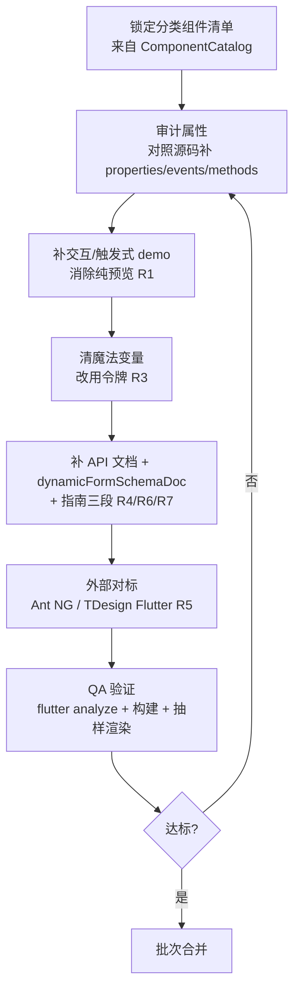
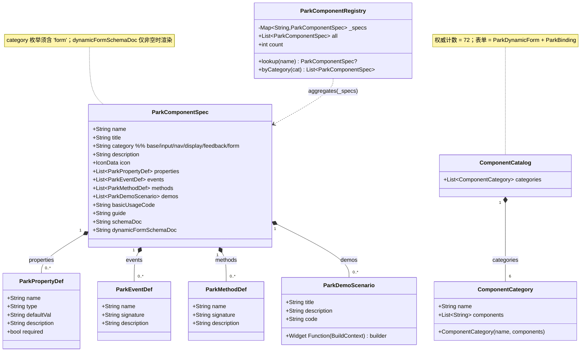
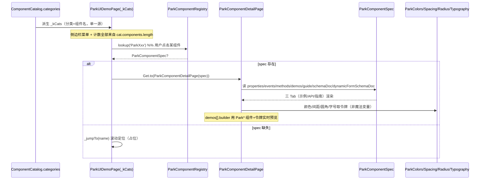

# P2：组件展示页全量完善 — 系统架构设计 + 任务分解

> 文档 owner：高见远（Gao，Architect）
> 输入：基于 `packages/park_ui/docs/P2_SHOWCASE_PRD.md`（许清楚，PM）
> 路径基准：项目根 `D:/project/javasup/park`
> 关联约定：`docs/park_ui_dev_convention.md`
> 语言：中文

---

## 0. 现状审计结论（必须先看）

在动手前，对 PM 提出的「关键发现」逐一落地核对源码，结论如下：

| # | 发现 | 代码实证 | 处置 |
|---|------|----------|------|
| A1 | `ComponentCatalog` 实际 **72** 个组件（6+19+10+23+12+2），但第 17 行注释写「71 个组件」 | `component_catalog.dart:17` | **改注释为 72** |
| A2 | `component_zh_names.dart` 注释写「共 71 个组件」，且表单键写 `'ParkBindable'`，与 `ComponentCatalog` 的 `'ParkBinding'` 不一致 | `component_zh_names.dart:5,89` vs `component_catalog.dart:116` | **改注释为 72；`ParkBindable` → `ParkBinding`** |
| A3 | `ParkComponentSpec.category` 注释枚举缺 `'form'` | `park_component_spec.dart:99` | **补 `'form'`** |
| A4 | `ParkComponentRegistry` 注释写「全部 71 个」、`byCategory` 注释枚举缺 `'form'`；`count` 由 Map 长度推导（自动=72，无需改逻辑） | `park_component_registry.dart:18,46` | **改注释；补 `'form'`** |
| A5 | 展示页 `park_ui_demo_page.dart` 已 **同源**：`_kCats` 由 `ComponentCatalog.categories` 派生，`_kCatIds` 已含 `'Park 表单'→'form'`，`_buildDemosFor` 已处理 `'form'`。✅ R2 在展示页已满足 | `park_ui_demo_page.dart:43-83,563-580` | 仅做 B7 魔法变量清理 |
| A6 | 详情页 `ParkComponentDetailPage._categoryLabel/_categoryColor` **无 `'form'` case**，表单组件详情页分类 chip 会回退为纯文本 + primary 色 | `park_component_detail_page.dart:1141-1174` | **补 `'form'` case（B0）** |
| A7 | `dynamicFormSchemaDoc` 字段与渲染 **已实现**（API Tab「方法」之后渲染），只需按约定补 16 个控件的文档 | `park_component_detail_page.dart:323-328` | B2 填内容 |
| A8 | 展示页 demo 代码 **魔法变量普遍**：`Color(0xFF1677FF)`、`BorderRadius.circular(...)`、`SizedBox(height:8)`、`EdgeInsets.*`、代码块背景 `Color(0xFF0D1117)` 等 | `park_ui_demo_page.dart` 全文 | B7 清理 |
| A9 | specs 范本 `park_base_specs.dart` 已遵循令牌约定（`_kColors/_kSpacing/_kTypography`），可作其余批次模板 | `park_base_specs.dart:17-19` | B1–B6 复用其写法 |

> **结论**：计数与「表单分类/命名」的不一致是 P2 的**首个阻塞点**，必须先在 B0 统一，否则 R2（菜单=展示一致）、R4（spec 分类聚合）全部失真。

---

## 1. 实现方案 + 框架选型

### 1.1 技术栈（重申，零新增三方依赖）

- **语言/框架**：Flutter / Dart（SDK 下限维持 `^3.11.5`）。
- **组件库**：自研 `park_ui`（Stripe 设计语言，MIT）。
- **状态/路由**：展示页用 `StatefulWidget` + `Get.to`（已有依赖，非新增）；无状态管理库。
- **令牌源**：`packages/park_ui/lib/src/theme/tokens/`（`park_colors` / `park_spacing` / `park_radius` / `park_typography` / `park_motion` / `park_shadows`）。**全部为零新增依赖、零新增包**。
- **为什么零新增**：展示页与 specs 均只消费 `park_ui` 导出的 `Park*` 组件与令牌；渲染 Markdown 用库内自研 `_buildGuideContent`，不引第三方 Markdown 库。

### 1.2 架构模式

采用 **数据驱动 + 单一数据源（SSOT）** 模式：

```
ComponentCatalog（权威清单：分类+组件名）
        │ 派生
        ├─▶ 展示页 _kCats（菜单/计数，杜绝双份清单）─── R2
        └─▶ ParkComponentRegistry（聚合 specs）───▶ 详情页三 Tab
                    ▲
        specs/*_specs.dart（每个组件一个 ParkComponentSpec）
```

- **展示页**：完全由 `ComponentCatalog.categories` 派生，自身不持有任何组件清单（已实现，A5）。
- **详情页**：以 `ParkComponentSpec` 为唯一渲染数据源，`demos[].builder` 实时预览、`properties/events/methods` 生成 API 表、`guide` 生成指南。
- **规格补全**：工程师只改 `specs/*.dart` + `park_ui_demo_page.dart`，展示/详情两端自动同步（新增组件仅改 `ComponentCatalog` + 注册一个 spec）。

### 1.3 技术难点与选型

| 难点 | 方案 |
|------|------|
| 72 组件规格补全工作量大、易与源码 API 漂移 | 以**源码公开构造参数**为准，逐参数补 `ParkPropertyDef`；以 `park_base_specs.dart` 为范本统一格式 |
| overlay 类组件（Dialog/Toast/Popup…）需「触发式」而非纯预览 | demo 页为每个 overlay 组件加 `ParkButton` 触发入口，`builder` 内调用 `showDialog`/`ParkToast.show` 等 |
| 魔法变量清零且主题感知 | 展示页复用既有 `_l*`/`_d*`（亮/暗）调色常量；specs 用 `ParkColors/Spacing/Radius/Typography` 令牌；代码块/动画等无令牌等价者抽具名常量 |
| 16 个控件 `dynamicFormSchemaDoc` 易编译失败（裸 `$`） | 严格按约定 `\u{24}` 转义；5 段固定模板；Dart 主 + JSON 括注 |
| 全项目 park 化替换原生控件风险 | 限定范围 `lib/` 业务/展示代码；`park_ui` 组件**内部实现**豁免；逐 PR 评审；`flutter analyze`+构建回归 |

### 1.4 单批执行流水线（每批内部）



---

## 2. 文件列表（相对路径）

> 相对项目根 `D:/project/javasup/park`。状态：🆕 新增 / ✏️ 修改 / 👁 只读参考。

| 文件 | 状态 | 涉及批次 | 说明 |
|------|------|----------|------|
| `packages/park_ui/lib/src/theme/tokens/park_colors.dart` | 👁 | — | 颜色令牌源（`brand/brandDark/success/error/warning/info/textSecondary/textOnBrand…`） |
| `packages/park_ui/lib/src/theme/tokens/park_spacing.dart` | 👁 | — | 间距令牌（`xxs..page` + `hGap/vGap`） |
| `packages/park_ui/lib/src/theme/tokens/park_radius.dart` | 👁 | — | 圆角令牌（`xs..full` + `brXs..brFull`） |
| `packages/park_ui/lib/src/theme/tokens/park_typography.dart` | 👁 | — | 字号/字重令牌 |
| `packages/park_ui/lib/src/theme/tokens/park_motion.dart` `park_shadows.dart` | 👁 | — | 动效/阴影令牌 |
| `lib/src/pages/components/component_catalog.dart` | ✏️ | B0/T00 | 注释 71→72（分类已含「表单」） |
| `lib/src/pages/park/component_zh_names.dart` | ✏️ | B0/T00 | 注释 71→72；`ParkBindable`→`ParkBinding` |
| `lib/src/pages/park/park_component_spec.dart` | ✏️ | B0/T00 | `category` 注释补 `'form'` |
| `lib/src/pages/park/park_component_registry.dart` | ✏️ | B0/T00 | 注释 71→72；`byCategory` 注释补 `'form'` |
| `lib/src/pages/park/park_component_detail_page.dart` | ✏️ | B0/T00 | `_categoryLabel/_categoryColor` 增 `'form'` case |
| `lib/src/pages/park/specs/park_base_specs.dart` | 👁 | B1/T01 | 范本（已基本完成，仅打磨） |
| `lib/src/pages/park/specs/park_input_specs.dart` | ✏️ | B2/T02 | 输入控件 spec |
| `lib/src/pages/park/specs/park_input_specs_p2.dart` | ✏️ | B2/T02 | P2 输入 spec |
| `lib/src/pages/park/specs/park_input_specs_extra.dart` | ✏️ | B2/T02 | 额外输入 spec |
| `lib/src/pages/park/specs/park_input_specs_group.dart` | ✏️ | B2/T02 | 组合输入 spec |
| `lib/src/pages/park/specs/park_nav_specs.dart` | ✏️ | B3/T03 | 导航 spec |
| `lib/src/pages/park/specs/park_nav_specs_extra.dart` | ✏️ | B3/T03 | 额外导航 spec |
| `lib/src/pages/park/specs/park_display_specs.dart` | ✏️ | B4/T04 | 展示 spec |
| `lib/src/pages/park/specs/park_display_specs_extra.dart` | ✏️ | B4/T04 | 额外展示 spec |
| `lib/src/pages/park/specs/park_feedback_specs.dart` | ✏️ | B5/T05 | 反馈 spec |
| `lib/src/pages/park/specs/park_feedback_specs_extra.dart` | ✏️ | B5/T05 | 额外反馈 spec |
| `lib/src/pages/park/specs/park_form_specs.dart` | ✏️ | B6/T06 | 动态表单 spec |
| `lib/src/pages/park/specs/park_binding_specs.dart` | ✏️ | B6/T06 | 绑定 spec（键已=`ParkBinding`） |
| `lib/src/pages/core/park_ui_demo_page.dart` | ✏️ | B7/T07 | 清理魔法变量（已同源，仅清字面量） |
| `docs/park_ui_dev_convention.md` | ✏️ | B0+B2 | 补 §3 占位（Demo/主题规范）、补 `form` 分类、引用 dynamicFormSchemaDoc 模板 |
| `packages/park_ui/docs/P2_ARCHITECT_DESIGN.md` | 🆕 | — | 本设计文档 |
| `test/park_ui/p2_count_test.dart`（建议新增） | 🆕 | B0/T00 | 断言 `ParkComponentRegistry.count == 72 == ComponentCatalog 总数` |

---

## 3. 数据结构与接口（类图 / Mermaid）



### 3.1 关键字段补全说明（实现点）

1. **`category` 对齐**：每个表单类 spec 必须 `category: 'form'`（`park_form_specs.dart` / `park_binding_specs.dart`）。`park_component_spec.dart:99` 注释补 `'form'`，否则 `byCategory('form')` 取空、详情页分类 chip 失真。
2. **`dynamicFormSchemaDoc`**：字段已存在于 `ParkComponentSpec`（第 130 行），详情页已在「方法」之后渲染（第 323–328 行）。B2 仅需为 16 个控件填内容（5 段模板见 §7.3）；跳过 `ParkInputGroup/ParkSegmented/ParkCalendar`（无 `fieldType`）；`ParkDynamicForm.schemaDoc` 已覆盖全量，不重复。
3. **`properties/events/methods` 补全**：以组件**源码公开构造参数**为准，逐参数一条 `ParkPropertyDef`；`demos[].code` 与 `demos[].builder` 必须**完全一致**（范本约定）。
4. **同源机制**：`kComponentZhNames`（键=`ParkXxx`）为唯一中文名源；展示页 `demoTitle(name)` 与 `ComponentCatalog` 共用；新增组件须三处同步（Catalog + spec 注册 + zh_names）。

---

## 4. 程序调用流程（时序图 / Mermaid）

展示页渲染一个组件 demo 的数据流（含详情页跳转）：



> 该流程证明 R2（菜单=展示同源）与 R3（令牌化）的实现路径：UI 层不直接持有组件清单，全部经 `ComponentCatalog` → `Registry` → `Spec` 派生。

---

## 5. 任务列表（有序、含依赖、按批次 B0–B7）

> 依赖关系：B0 为总前置；B1–B6 彼此**可并行**（各自独立改 specs 文件），均依赖 B0；B7 建议在 B1–B6 之后执行（清理既有 demo 页 + 全项目 park 化），亦可并行启动。

### 批次总览

| 批次 | 分类 | 覆盖组件 | 优先级映射 | T 编号 |
|------|------|----------|-----------|--------|
| **B0** | 基建对齐 | 计数/分类/命名统一 | R2 基线 | T00 |
| **B1** | 基础 Base | 6 | R1/R3/R4/R5/R7 | T01 |
| **B2** | 输入 Input | 19（含 16 个 dynamicFormSchemaDoc） | R1/R3/R4/R5/R6/R7 | T02 |
| **B3** | 导航 Navigation | 10（Drawer/Popup/SideBar 触发式） | R1/R3/R4/R5/R7 | T03 |
| **B4** | 展示 Display | 23 | R1/R3/R4/R5/R7 | T04 |
| **B5** | 反馈 Feedback | 12（Dialog/Toast…触发式） | R1/R3/R4/R5/R7 | T05 |
| **B6** | 表单 Form | 2（ParkDynamicForm + ParkBinding） | R1/R3/R4/R5/R7 | T06 |
| **B7** | 魔法变量 + park 化 | 全站 demo 页 + `lib/` | R3/R8 | T07 |

---

### T00 · B0 数据同源与计数对齐（基建，前置）

- **依赖**：无
- **覆盖**：`component_catalog.dart`、`component_zh_names.dart`、`park_component_spec.dart`、`park_component_registry.dart`、`park_component_detail_page.dart`、`docs/park_ui_dev_convention.md`
- **具体改动**：
  1. `component_catalog.dart:17` 注释「71」→「72」。
  2. `component_zh_names.dart:5` 注释「71」→「72」；第 89 行 `'ParkBindable'` → `'ParkBinding'`（与 Catalog、registry 键一致，A2/A9）。
  3. `park_component_spec.dart:99` `category` 注释补 `form`。
  4. `park_component_registry.dart:18` 注释「71」→「72」；`byCategory` 注释补 `form`。
  5. `park_component_detail_page.dart` `_categoryLabel`/`_categoryColor` 增 `case 'form'`（`form` 中文「表单」+ 配色，避免回退 primary）。
  6. `docs/park_ui_dev_convention.md` 补 `form` 分类说明，将 §3 占位「Demo 编写规范 / 主题与无障碍规范」落地为可执行条款（引用 §7 共享知识）。
  7. 新增 `test/park_ui/p2_count_test.dart`：断言 `ParkComponentRegistry.count == 72` 且等于 `ComponentCatalog.categories` 展开总数。
- **完成判定**：`flutter analyze` 零错误；测试通过；`registry.count==72`；详情页表单组件 chip 显示「表单」。

---

### T01 · B1 基础组件完善（6）

- **依赖**：T00
- **覆盖**：`park_base_specs.dart`（ParkButton/ParkText/ParkIcon/ParkDivider/ParkFab/ParkLink，范本已基本完成）
- **具体改动**：
  1. 审计 6 组件属性，对照源码补齐 `properties/events/methods`（范本已较全，核对有无遗漏/虚构）。
  2. 每个组件保证 ≥1 个**交互/触发式** demo（Button 已交互；Text/Icon/Divider/Fab/Link 确认非纯预览）。
  3. 全文件零魔法变量（范本已用 `_kColors/_kSpacing/_kTypography`，复查有无裸 `Color/EdgeInsets/BorderRadius/SizedBox`）。
  4. 对标 Ant NG「通用/排版」+ TDesign Flutter 基础组件，差异记入内部对标表；缺失能力标 known-limit。
  5. 指南三段（`何时使用/使用建议/搭配推荐`）结构一致，搭配指向真实 park 组件。
- **完成判定**：analyze+构建通过；6 组件三 Tab 完整；≥1 交互示例/组件；grep 无裸字面量。

---

### T02 · B2 输入组件完善（19 + 16 个 dynamicFormSchemaDoc）

- **依赖**：T00
- **覆盖**：`park_input_specs.dart` / `park_input_specs_p2.dart` / `park_input_specs_extra.dart` / `park_input_specs_group.dart`
- **具体改动**：
  1. 19 组件 spec 补全 `properties/events/methods` + 交互 demo（输入类天然交互，确认无纯预览）。
  2. **为 16 个控件补 `dynamicFormSchemaDoc`**（5 段模板，见 §7.3；`\u{24}` 转义）：ParkInput、ParkTextarea、ParkSearch、ParkSwitch、ParkCheckbox、ParkRadio、ParkSelect、ParkDatePicker、ParkPicker、ParkCascader、ParkTreeSelect、ParkSlider、ParkStepper、ParkRate、ParkUpload、ParkForm。
  3. **跳过**：ParkInputGroup / ParkSegmented / ParkCalendar（无 `fieldType`，不补）。
  4. 全文件零魔法变量；对标 Ant NG「数据录入」+ TDesign 输入类。
  5. 指南三段。
- **完成判定**：同上 + 16 个 `dynamicFormSchemaDoc` 非空且结构合规（5 段齐全）；编译通过（无裸 `$` 错误）。

---

### T03 · B3 导航组件完善（10，触发式入口）

- **依赖**：T00
- **覆盖**：`park_nav_specs.dart` / `park_nav_specs_extra.dart`
- **具体改动**：
  1. 10 组件 spec 补全 + 交互/触发式 demo。
  2. **重点**：`ParkDrawer`/`ParkPopup`/`ParkSideBar` 必须有**触发按钮**演示打开（overlay/抽屉类不能只预览）。
  3. 全文件零魔法变量；对标 Ant NG「导航」+ TDesign 导航类。
  4. 指南三段。
- **完成判定**：同上 + overlay/抽屉类确认有触发按钮。

---

### T04 · B4 展示组件完善（23）

- **依赖**：T00
- **覆盖**：`park_display_specs.dart` / `park_display_specs_extra.dart`
- **具体改动**：
  1. 23 组件 spec 补全 + 交互 demo（Avatar/Badge/Tag/Card/Image/Swiper/Table…）。
  2. 全文件零魔法变量；对标 Ant NG「数据展示」+ TDesign 展示类。
  3. 指南三段。
- **完成判定**：analyze+构建通过；23 组件三 Tab 完整；grep 无裸字面量。

---

### T05 · B5 反馈组件完善（12，触发式入口）

- **依赖**：T00
- **覆盖**：`park_feedback_specs.dart` / `park_feedback_specs_extra.dart`
- **具体改动**：
  1. 12 组件 spec 补全 + **触发式 demo**。
  2. **重点**：`ParkDialog`/`ParkToast`/`ParkPopup`/`ParkActionSheet`/`ParkDropdownMenu`/`ParkPopover`/`ParkOverlay` 均需 `ParkButton` 触发演示。
  3. 全文件零魔法变量；对标 Ant NG「反馈」+ TDesign 反馈类。
  4. 指南三段。
- **完成判定**：同上 + 全部反馈类确认有触发入口。

---

### T06 · B6 表单组件完善（2）

- **依赖**：T00
- **覆盖**：`park_form_specs.dart` / `park_binding_specs.dart`
- **具体改动**：
  1. `ParkDynamicForm`：spec 补全（属性/事件/方法）+ 联动/字段类型 demo（demo 页 `_FormDemos` 已较全，核对与 spec 一致）；`schemaDoc` 已覆盖全量，无需新增 `dynamicFormSchemaDoc`。
  2. `ParkBinding`（`park_binding_specs.dart` 键已=`ParkBinding`）：补 spec + 双向绑定 demo + 指南；`category: 'form'`。
  3. 全文件零魔法变量；对标 Ant NG「表单」+ TDesign 表单类。
- **完成判定**：analyze+构建通过；2 组件三 Tab 完整；表单分类在菜单/详情一致。

---

### T07 · B7 魔法变量清理 + 全项目 park 化（收尾）

- **依赖**：T00（建议 B1–B6 后执行，可并行）
- **覆盖**：`lib/src/pages/core/park_ui_demo_page.dart` + 全 `lib/` 业务/展示代码
- **具体改动**：
  1. **清理 `park_ui_demo_page.dart` 魔法变量**（A8）：将裸 `Color(0xFF1677FF)`→`_lBrand/_dBrand`、`Color(0xFFF5F7FA)`→`_lBg`、`BorderRadius.circular`→`ParkRadius.defaults().brXxx`、`SizedBox/EdgeInsets` 数字→`ParkSpacing` 命名值、代码块背景 `Color(0xFF0D1117)`→抽 `_lCodeBg/_dCodeBg` 常量；复用既有 `_l*`/`_d*` 与 `_kHeaderH`。
  2. **全项目 park 化（R8）**：`lib/` 业务/展示代码中 `ElevatedButton`→`ParkButton`、`Text`→`ParkText`、`Icon`→`ParkIcon`、`Divider`→`ParkDivider`、`Card`→`ParkCard`（及 `OutlinedButton`/`TextButton`→`ParkButton` 变体）；**park_ui 组件内部实现豁免**。
  3. 逐 PR 评审；构建 + 关键路由回归。
- **完成判定**：全仓 grep 无裸颜色/圆角/间距/字号字面量（令牌与 `_l*`/`_d*` 除外）；`flutter analyze`+构建通过；视觉回归无变化；无应替换而未替换的原生控件（组件内部除外）。

---

## 6. 依赖包列表

**无需新增任何第三方依赖。** 全部修改仅消费已有 `park_ui` 导出（组件 + 令牌）与项目既有 `get`（展示页路由，非新增）。

```
# 无新增依赖。确认项（均为既有）：
# flutter / dart SDK  ^3.11.5
# park_ui            (本库，组件 + 设计令牌源)
# get                (既有，展示页 Get.to 路由)
```

---

## 7. 共享知识（跨文件约定）

### 7.1 魔法变量替代映射表（强制）

| 魔法写法（禁止） | 替代（推荐） |
|------------------|--------------|
| `Color(0xFF1677FF)` 品牌蓝 | 主题感知用 `_lBrand`/`_dBrand`（demo 页已定义）；非主题感知用 `ParkColors.light().brand` |
| `Color(0xFFF5F7FA)` 背景 | `_lBg` / `_dBg` |
| `Color(0xFFFFFFFF)` 卡片 | `_lCard` / `_dCard` |
| `Color(0xFFE8ECF0)` 边框 | `_lBorder` / `_dBorder` |
| `Color(0xFF1D2129)` / `Color(0xFF86909C)` 文字 | `_lText1`/`_lText2` |
| `Color(0xFF0D1117)` / `Color(0xFFF6F8FA)` 代码块背景 | 抽 `_lCodeBg`/`_dCodeBg` 具名常量 |
| `Colors.white` / `Colors.grey` / `Colors.transparent` | 主题感知用 `_lText1` 等；`Colors.transparent` 无令牌等价可保留 |
| `BorderRadius.circular(10/8/6/4…)` | `ParkRadius.defaults().brMd/brSm/brXs`（`brXs..brFull`） |
| `EdgeInsets.all(12)` / `EdgeInsets.only(...)` / `EdgeInsets.symmetric(...)` | `EdgeInsets.all(_kSpacing.md)`、`EdgeInsets.only(left:_kSpacing.md,…)`；或 `ParkSpacing.defaults().hGap()/.vGap()` |
| `SizedBox(height:8)/width:12` | `SizedBox(height:_kSpacing.sm)` / `ParkSpacing.defaults().vGap(_kSpacing.sm)` |
| `Padding(padding: const EdgeInsets.fromLTRB(20,16,20,0))` | `EdgeInsets.fromLTRB(_kSpacing.xl,_kSpacing.md,_kSpacing.xl,0)` |
| 字体 `fontSize:15` 等裸字号 | `ParkTypography.defaults().sizeH3/…` 或直接用 `ParkText(preset:)` |
| `const Duration(milliseconds:350)` | 动画时长非令牌，可保留或抽 `_kAnimMs` 具名常量 |

### 7.2 `_l*` / `_k*` 常量复用规则

- **demo 页（`park_ui_demo_page.dart`）**：已定义亮/暗调色常量 `_lBrand/_lBg/_lCard/_lBorder/_lText1/_lText2/_lSidebar` 与 `_dBrand/_dBg/...`。凡是**主题感知**的颜色必须复用这些常量，不要新写 `Color(0xFF…)`。
- **specs 文件**：范本 `park_base_specs.dart` 已用 `final _kColors = ParkColors.light()`、`_kSpacing = ParkSpacing.defaults()`、`_kTypography = ParkTypography.defaults()`。其余批次**统一沿用 `_kColors/_kSpacing/_kTypography`** 命名，避免新增局部常量。
- 具名粗细/截断宽度等局部常量（如 `_kThicknessThin`）仅在 specs 内复用，不外溢。

### 7.3 `dynamicFormSchemaDoc` 5 段模板（来自约定文档 §2.3，强制顺序）

```
### 对应字段类型        → ParkFieldType.xxx（ParkInput 写 text 与 number）
### 适用场景            → 1-3 句
### 关键 schema 属性     → Markdown 表：属性(Dart) | JSON 键 | 说明 | 必填（只列该控件真用得上的）
### 最小可用示例         → ```dart 一个 ParkFormFieldSchema(...) 或含该字段的 ParkFormSchema
### 进阶技巧             → 列表（fieldControl 子类型 / uiConfig / dataSource / reaction 等）
```
- 字段命名：**Dart 属性名为主**，JSON 键括注（如 `fieldName`（JSON: `field_name`/`key`））。
- `\u{24}` 转义：示例/表中运行期文本 `$form.xxx` 在源码多行字符串内必须写成 `\u{24}form.xxx`（避开 Dart 插值）。

### 7.4 `category` 枚举约定（权威）

```
base | input | nav | display | feedback | form
```
- 表单类 spec 一律 `category: 'form'`；详情页 `_categoryLabel/_categoryColor` 与 demo 页 `_kCatIds/_kCatLabels` 均已含 `form`，**新增组件禁止新增分类值**。

### 7.5 对标范围约定（R5）

- 基础/输入/导航/展示/反馈**全量保底**「功能 demo + 属性文档」；高频类（基础/输入/反馈）**深度对标** Ant NG（`ng.ant.design/components/overview/zh`）与 TDesign Flutter（`tdesign.tencent.com/flutter`）。
- 差异表为**内部 wiki**，展示页只体现补齐后的能力（Q7 默认）。
- 展示页「快速上手」含 `install / import / SDK 最低版本`（版本号待 Q3 拍板，先用占位 `^0.1.0` 并标注 TODO）。

---

## 8. 待明确事项

### 8.1 已决议（用户可推翻）

| 项 | 决议 |
|----|------|
| 计数基准 | 以 `ComponentCatalog` 实际内容为准 = **72**；表单 = `ParkDynamicForm` + `ParkBinding` |
| 对标范围 | 72 组件全部保底「功能 demo + 属性文档」；高频类深度对标 Ant NG + TDesign Flutter |
| 文档语言 | 中文为主 |
| SDK 下限 | 维持 `^3.11.5` |
| 全项目 park 化（Q6/R8） | 纳入 P2 作为收尾批次（B7），非阻塞；park 组件内部实现豁免 |
| 表单命名 | `component_zh_names.dart` 的 `ParkBindable` 统一为 `ParkBinding`（与 Catalog/registry 一致） |

### 8.2 仍待用户确认

| # | 问题 | 影响 | 建议默认 |
|---|------|------|----------|
| Q1 | 组件计数基准是否已确认=72（含 `ParkBinding`）？ | B0/B6 范围 | 已按 72 规划 |
| Q2 | 72 组件是否全部逐一对标，还是抽样？ | R5 工期 | 基础/输入/反馈全对标；展示/导航/表单抽样 + known-limit |
| Q3 | 展示页「快速上手」正式 Flutter/Dart 最低版本与 `park_ui` 版本号？ | R5 安装说明准确性 | 占位 `^0.1.0` + `sdk: '>=3.11.5'`，待维护者给出 |
| Q4 | 是否需要英文 API/指南与展示页 i18n？ | 是否升级 R8 为 P1 | 暂不做（P2），仅中文 |
| Q5 | `ParkComponentSpec.category` 是否确认补 `'form'`？ | R2 分类一致性 | 已决议：补 `'form'` |
| Q6 | 全项目 park 化是否含全部 `lib/`、是否允许逐项 PR、有无白名单？ | R8 工作量/风险 | 含全部 `lib/` 业务/展示；park 内部豁免；逐 PR 评审 |
| Q7 | 对标差异表放展示页内还是仅内部 wiki？ | R5 交付物形态 | 内部 wiki + 展示页仅体现补齐后能力 |
| Q8 | demo 页路径确认 = `lib/src/pages/core/park_ui_demo_page.dart`？ | B7 执行对象 | 已确认（实测路径） |

---

> 附：类图见 `docs/class-diagram.mermaid`，时序图见 `docs/sequence-diagram.mermaid`。
