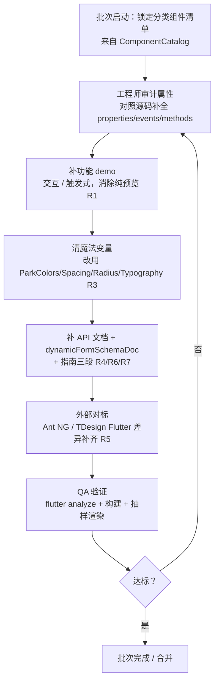
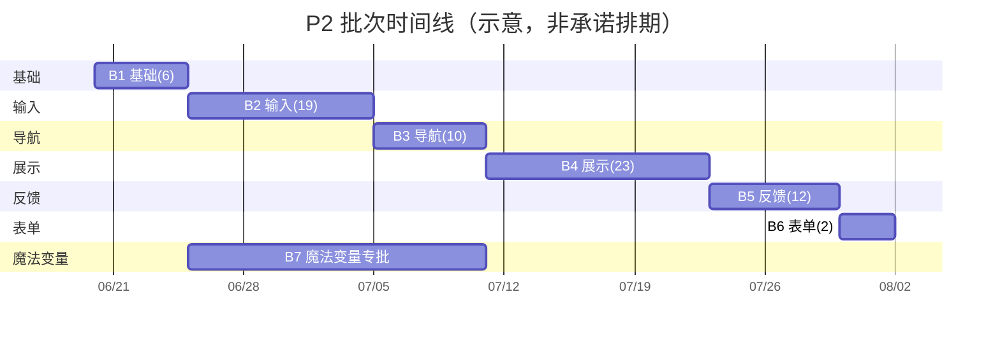

# P2：组件展示页全量完善 — 产品需求文档（简单 PRD）

> 文档 owner：许清楚（Xu，Product Manager）
> 适用范围：park_ui Flutter 组件库展示页发布前质量基线
> 单一权威数据源：`lib/src/pages/components/component_catalog.dart`（`ComponentCatalog`）
> 关联约定：`docs/park_ui_dev_convention.md`
> 语言：中文

---

## 1. 产品目标

在发布前，将 park_ui 展示页（底部「组件总览」菜单 + 组件详情三 Tab：示例 / API / 指南）的质量基线锁定到「可对外对标」水平——对标 Ant Design NG 与 TDesign Flutter。每个组件都要「讲得清怎么用、查得到属性、看得齐功能、描得准对标」；全站零魔法变量，统一使用设计令牌（ParkColors / ParkSpacing / ParkRadius / ParkTypography）；底部菜单与展示内容严格以 `ComponentCatalog` 为单一数据源，杜绝两份清单漂移。目标不是新增组件能力，而是把已有 72 个组件的「展示与文档」补齐到对外可交付标准。

---

## 2. 用户故事

| # | 角色 | 故事 | 价值 |
|---|------|------|------|
| US-1 | 开发者（使用者） | 作为开发者，我希望每个组件都演示「怎么用」（含触发式用法，如抽屉有打开按钮），以便我能直接照抄落地 | 降低上手成本，减少源码翻查 |
| US-2 | 开发者（使用者） | 作为开发者，我希望每个属性 / 事件 / 方法都有注释 + 代码示例，以便快速查 API | 无需读源码即可集成 |
| US-3 | 选型决策者 | 作为选型者，我希望展示页逐一对标 Ant NG / TDesign Flutter，以便评估 park_ui 能力覆盖度 | 缩短技术选型决策周期 |
| US-4 | 库维护者 | 作为维护者，我希望底部菜单与展示内容以 `ComponentCatalog` 为唯一数据源，以便不会出现「两边对不上」 | 新增/下线组件只改一处 |
| US-5 | 贡献者 | 作为贡献者，我希望全站 demo 使用设计令牌，以便在改主题时一处生效、无魔法变量漂移 | 主题一致性、可维护性 |

---

## 3. 需求池（按 P0 / P1 / P2 分级，映射到批次 1–7）

优先级定义：**P0** 发布前必须（Must）；**P1** 应做（Should）；**P2** 锦上添花（Nice to have）。

| 编号 | 优先级 | 需求 | 映射批次 | 验收标准 |
|------|--------|------|----------|----------|
| R1 | P0 | **用法而非纯预览**：每个组件在展示页至少有 1 个「可交互 / 触发式」示例；overlay 类组件（Drawer / Dialog / Toast / Popup / ActionSheet / DropdownMenu / Popover / Overlay 等）必须有触发入口演示打开；全局排查预览型 demo 并改写 | 1–6 | ① `flutter analyze` 零错误；② 全部 72 组件在 demo 页均有 ≥1 个交互/触发式示例；③ overlay 类组件确认有触发按钮；④ 无「只展示不演示用法」的纯预览区块 |
| R2 | P0 | **底部菜单 = 展示页总览**：底部组件菜单与展示页组件集合 / 分类完全一致，统一以 `ComponentCatalog` 为单一数据源，禁止在 demo 页或详情页硬编码组件清单 | 1–7（基线） | ① 删除 demo 页 / 详情页中与 `ComponentCatalog` 重复的硬编码清单；② 两侧计数、中文名（`component_zh_names.dart`）、分类标签完全一致；③ 新增组件仅改 `ComponentCatalog` 即两端同步 |
| R3 | P0 | **零魔法变量**：demo 页与 specs 文件中禁止裸 `Colors.x` / `EdgeInsets.all` / `SizedBox(xx)` / `BorderRadius.circular`，一律改用 `ParkColors` / `ParkSpacing` / `ParkRadius` / `ParkTypography`；可复用已有 `_lBrand/_lBg/_lCard/_lBorder/_lText1/_lText2` 与 `_kColors/_kSpacing/_kTypography` | 7 + 各批新增代码 | ① 全仓 grep 无裸字面量（颜色 / 圆角 / 间距 / 字号）；② `flutter analyze` + 构建通过；③ 视觉回归无变化 |
| R4 | P1 | **对外 API 文档**：每个组件 `ParkComponentSpec` 的 `properties` / `events` / `methods` 全部补全，且每个非平凡属性/事件/方法在详情页有注释 + 演示示例（`spec.demos` 即示例） | 1–6 | ① 72 组件 spec 的 properties/events/methods 与组件实际公开 API 一致（无遗漏、无虚构）；② 每个关键属性/事件/方法至少 1 个 demo 或代码演示；③ `basicUsageCode` 非空 |
| R5 | P1 | **外部对标深挖**：逐组件对标 Ant NG（`ng.ant.design/components/overview/zh`）与 TDesign Flutter（`tdesign.tencent.com/flutter`），补齐组件 / 示例 / 功能 / 属性 / 变量；并在展示页补充 park 用法、安装要求 / 依赖 / 引入 / SDK 版本 | 1–6 | ① 每个分类产出对标差异表（已覆盖 / 缺失 / 部分支持）；② 缺失能力或示例已补或标记为产品确认的 known-limit；③ 展示页「快速上手」区块含 install / import / SDK 最低版本 |
| R6 | P1 | **dynamicFormSchemaDoc**：按约定为 16 个自定义输入控件补 `dynamicFormSchemaDoc`（顺序固定 5 段，字段命名 Dart 主 + JSON 括注，`$` 转义为 `\u{24}`） | 2 | ① 16 个控件 `dynamicFormSchemaDoc` 均非空且结构合规；② 跳过项（`ParkInputGroup` / `ParkSegmented` / `ParkCalendar`，无 `fieldType`）已确认；③ 编译通过（无裸 `$` 插值错误） |
| R7 | P2 | **指南结构一致**：每个组件 `guide` 字段含「何时使用 / 使用建议 / 搭配推荐」三段（以 park_base_specs 为范本） | 1–6 | ① 72 组件 `guide` 非空；② 三段结构一致；③ 搭配推荐指向真实存在的 park 组件 |
| R8 | P0 | **全项目 park 化**：排查 `lib/` 所有该用 park 组件处，替换原生控件（如 `ElevatedButton`→`ParkButton`、`Text`→`ParkText`、`Icon`→`ParkIcon`、`Divider`→`ParkDivider`、`Card`→`ParkCard` 等） | 1–7（并行） | ① 业务/展示代码中无应替换而未替换的原生控件（park 组件内部实现除外）；② 至少一个全项目替换 PR 通过评审；③ 构建 + 关键路由回归通过 |

> 注：P0 合计 = R1 + R2 + R3 + R8（质量红线，不可妥协）；P1 = R4 + R5 + R6；P2 = R7。

---

## 4. 批次计划（有序 7 批）

每批执行流水线（详见下方 Mermaid 流程图）：**审计属性 → 补功能 demo（交互/触发式）→ 清魔法变量 → 补 API 文档 + dynamicFormSchemaDoc + 指南 → 外部对标 → QA 验证（flutter analyze + 构建 + 抽样渲染）**。

### 4.1 批次明细

| 批次 | 分类 | 覆盖组件（数量） | 本批交付物 | 完成判定 |
|------|------|------------------|------------|----------|
| **B1** | 基础 Base | ParkButton、ParkText、ParkIcon、ParkDivider、ParkFab、ParkLink（**6**） | 6 组件 spec 补全（properties/events/methods/demos/guide）；Button 已交互，其余补交互/触发示例；零魔法变量；对标 Ant/TDesign 基础组件 | analyze+构建通过；6 组件三 Tab 完整；≥1 交互示例/组件；无魔法变量 |
| **B2** | 输入 Input | ParkInput、ParkTextarea、ParkSearch、ParkSwitch、ParkCheckbox、ParkRadio、ParkSelect、ParkDatePicker、ParkPicker、ParkCascader、ParkTreeSelect、ParkSlider、ParkStepper、ParkRate、ParkUpload、ParkForm、ParkSegmented、ParkCalendar、ParkInputGroup（**19**） | 19 组件 spec 补全 + 交互 demo；**16 个控件补 `dynamicFormSchemaDoc`**；对标 input 类 | 同上 + 16 个 `dynamicFormSchemaDoc` 非空且结构合规 |
| **B3** | 导航 Navigation | ParkTabs、ParkTabBar、ParkNavBar、ParkSideBar、ParkSteps、ParkDrawer、ParkBackTop、ParkIndexes、ParkBreadcrumb、ParkPagination（**10**） | 10 组件 spec + 交互 demo（**Drawer/Popup/SideBar 必须有触发入口**）；对标 nav 类 | 同上 + overlay 类确认有触发按钮 |
| **B4** | 展示 Display | ParkAvatar、ParkBadge、ParkCell、ParkDescriptions、ParkTag、ParkCollapse、ParkEmpty、ParkImage、ParkImageViewer、ParkProgress、ParkResult、ParkSkeleton、ParkSwiper、ParkTable、ParkCounter、ParkFooter、ParkGrid、ParkList、ParkEllipsis、ParkTimeline、ParkTooltip、ParkSticky、ParkCard（**23**） | 23 组件 spec + demo + 对标 display 类 | 同上 |
| **B5** | 反馈 Feedback | ParkDialog、ParkToast、ParkLoading、ParkActionSheet、ParkPopup、ParkDropdownMenu、ParkNoticeBar、ParkMessage、ParkPopover、ParkRefresh、ParkSwipeCell、ParkOverlay（**12**） | 12 组件 spec + **触发式 demo**（Dialog/Toast/Popup/ActionSheet/DropdownMenu/Popover/Overlay 均需按钮触发）；对标 feedback 类 | 同上 + 全部反馈类确认有触发入口 |
| **B6** | 表单 Form | ParkDynamicForm、ParkBinding（**2**，见待确认 Q1） | 2 组件 spec + 联动/字段类型 demo + 动态表单指南；`ParkDynamicForm.schemaDoc` 已覆盖全量，无需新增 `dynamicFormSchemaDoc` | 同上 |
| **B7** | demo 页魔法变量专批 | 全站 demo 页 `lib/src/pages/core/park_ui_demo_page.dart` 及 `lib/src/pages/park/specs/*` | 清理裸 `Colors` / `EdgeInsets` / `SizedBox` / `BorderRadius`，改用令牌；复用 `_l*` / `_k*` 常量 | grep 无裸字面量；构建通过；视觉回归无变化 |

> ⚠️ **计数差异提示**：既有计划写「表单 1 个 / 总计 71」，但 `ComponentCatalog` 实际列 **72** 个（表单 = `ParkDynamicForm` + `ParkBinding` 两个）。本表以 `ComponentCatalog` 为权威，按 72 个规划；B6 覆盖 2 个。最终基准以「待确认 Q1」拍板为准。

### 4.2 单批执行流水线（流程图）

### 4.3 批次时序（甘特示意）

---

## 5. 待确认问题（需用户拍板）

| # | 问题 | 影响 | 建议默认 |
|---|------|------|----------|
| **Q1** | **组件计数基准**：`ComponentCatalog` 实际 72 个（表单 = `ParkDynamicForm` + `ParkBinding` 两个），但既有口径与源码注释均为「71 / 表单 1 个」。展示页基准计数与 B6 范围以哪个为准？是否含 `ParkBinding`？ | 影响 B6 覆盖组件数、registry 注释修正、QA 计数断言 | 以 `ComponentCatalog` 为准 = 72，B6 含 2 个；同步修正「71」注释 |
| **Q2** | **对标深度**：72 组件是否全部逐一对标 Ant NG + TDesign，还是先重点（基础/输入/反馈）全对标、展示/导航/表单抽样对标？ | 影响 R5 工期与人力 | 基础/输入/反馈全对标；展示/导航/表单抽样 + 已知缺口清单 |
| **Q3** | **SDK 最低版本声明**：展示页「快速上手」需写明 Flutter / Dart 最低版本与 `park_ui` 依赖版本（当前示例写 `^0.1.0`）。正式版本号与 SDK 约束？ | 影响 R5 安装说明准确性 | 由维护者给出正式 `sdk: '>=x.y.z'` 与 `park_ui` 版本 |
| **Q4** | **英文文档**：是否需要英文 API / 指南与展示页 i18n？ | 决定 R8 是否升级为 P1 | 暂不做（P2），仅中文 |
| **Q5** | **分类枚举一致性**：`ParkComponentSpec.category` 注释仅列 `base/input/nav/display/feedback`（缺 `form`）。表单类 spec 是否使用 `'form'` 分类？需与 `ComponentCatalog` 的 `'Park 表单' → 'form'` 映射对齐，避免 `byCategory('form')` 取空 | 影响 R2 分类一致性、详情页按分类聚合 | 表单 spec `category: 'form'`；更新 `ParkComponentSpec` 注释枚举 |
| **Q6** | **全项目 park 化范围**：`lib/` 是否全部包含（含非展示业务页）？是否允许逐项 PR 评审？是否有暂不替换白名单（如第三方库内部、性能敏感处）？ | 影响 R8 工作量与风险 | 含全部 `lib/` 业务/展示代码；park 组件内部实现除外；逐 PR 评审 |
| **Q7** | **对标产出形式**：对标差异表放在展示页内（如每组件「对标」小节）还是仅内部 wiki / 文档？ | 影响 R5 交付物形态 | 内部差异表（wiki）+ 展示页仅体现补齐后的能力 |
| **Q8** | **demo 页路径**：brief 称 demo 页在 `lib/src/pages/park/park_ui_demo_page.dart`，实测在 `lib/src/pages/core/park_ui_demo_page.dart`。B7 清理以哪个文件为准？ | 影响 B7 执行对象 | 以实测 `lib/src/pages/core/park_ui_demo_page.dart` 为准 |

---

## 6. 执行备注（工程师可直接使用）

- **令牌源**：`packages/park_ui/lib/src/theme/tokens/`（`park_colors` / `park_spacing` / `park_radius` / `park_typography` / `park_motion` / `park_shadows`）。
- **规格引擎**：`lib/src/pages/park/park_component_spec.dart`（`ParkComponentSpec` + `ParkPropertyDef` / `ParkEventDef` / `ParkMethodDef` / `ParkDemoScenario`）。
- **注册表**：`lib/src/pages/park/park_component_registry.dart`（聚合 specs 文件；请核对实际注册数 = `ComponentCatalog` 数 = 72，并修正注释「71」）。
- **已知良好范本**：`lib/src/pages/park/specs/park_base_specs.dart`（已用 `_kColors/_kSpacing/_kTypography` 令牌、demos 的 `code` 与 `builder` 一致、guide 三段结构）——作为其余批次的编写模板。
- **质量红线**（不可妥协）：① 禁止魔法变量；② 每个组件功能 demo 齐 + 属性文档齐 + 对标 Ant NG/TDesign；③ 底部菜单与展示页组件集合/分类完全一致。
