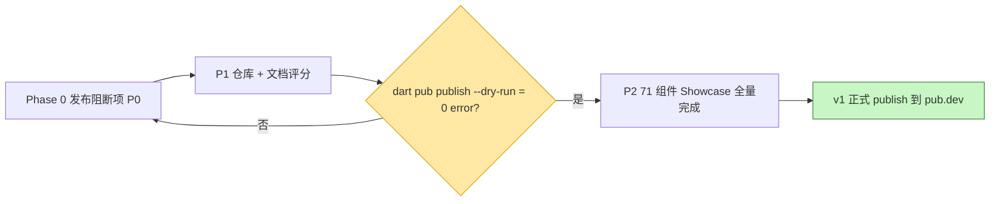

# park_ui 发布 PRD（简单版）

> 版本：v0.1.0-draft ｜ 角色：Product Manager（许清楚 / Xu）｜ 语言：中文
> 范围：将 `park_ui` Flutter 组件库公开发布到 pub.dev（先完成 71 组件 Showcase，再发布 v1）

---

## 1. 产品目标

我们要把 `park_ui`（自包含、Stripe 设计语言的 Flutter 组件库，含 71 个组件、仅依赖 `flutter` + `equatable`、无本地 `path` 依赖）从 `park` monorepo 内的私有 `path:` 依赖，改造为可公开发布的 pub.dev 包；**先完成应用端 71 组件 Showcase 与质量验证，再正式发布 v1**，使任意 Flutter 工程可通过 `flutter pub add park_ui` 一键集成一套文档完备、质量可验证的组件库。

---

## 2. 用户故事

| # | 用户故事（作为…我希望…以便…） |
|---|---|
| US-1 | 作为 **Flutter 开发者**，我希望通过 `flutter pub add park_ui` 即可安装组件库，以便无需复制代码或依赖本地路径即可复用 71 个标准化组件。 |
| US-2 | 作为 **`park` 应用维护者**，我希望本地开发时仍能通过 `path:` 引用 `park_ui`，以便在发布前继续快速迭代且不被破坏现有工程。 |
| US-3 | 作为 **开源使用者**，我希望在 pub.dev 上看到清晰的 README、可运行 example 应用与 `///` API 文档，以便快速上手并理解每个组件的属性与用法。 |
| US-4 | 作为 **组件库贡献者**，我希望 `park_ui` 拥有独立 GitHub 仓库与 MIT 许可，以便我能提交 issue/PR 并合规地二次使用。 |
| US-5 | 作为 **团队 PM**，我希望发布前先完成 71 组件 Showcase 与对标（Ant Design NG / TDesign），以便 v1 的组件质量与一致性经过验证再对外发布。 |

---

## 3. 需求池（优先级：P0 必须 / P1 应当 / P2 锦上添花）

### P0 — Phase 0 发布阻断项（任何发布前必须完成）

| ID | 需求 | 说明 / 验收点 |
|----|------|--------------|
| P0-1 | 删除垃圾文件 `_scan2.py` | `packages/park_ui/_scan2.py`（非库代码，会污染包）；删除后确认不在包内。 |
| P0-2 | 新增 MIT `LICENSE` | 置于 `packages/park_ui/LICENSE`。 |
| P0-3 | 新增 `README.md` | park_ui 专属：安装方式、基础用法、6 大类组件索引（基础/输入/导航/展示/反馈/表单）。 |
| P0-4 | 新增 `CHANGELOG.md` | 以 `## 0.1.0` 起始，记录初始发布内容。 |
| P0-5 | 新增 `.pubignore` | 排除 `build/`、`.dart_tool/`、`_scan2.py`、CI/本地配置等非发布文件。 |
| P0-6 | 修复 `pubspec.yaml` | ① 移除 `publish_to: 'none'`；② 移除 `resolution: workspace`；③ 新增 `repository` / `homepage` / `issue_tracker` 指向 GitHub 仓库；④ `description` 计数 56→**71**；⑤ 复核 `environment` SDK 约束满足 pub.dev 合规。 |
| P0-7 | 创建 `example/` 可运行示例应用 | pub.dev 会构建；`flutter create` 风格最小 app，`import 'package:park_ui/...'` 并展示若干组件；其 `pubspec` 能正确引用 `park_ui`。 |

### P1 — 仓库与文档完备性（影响 pub.dev 评分与协作）

| ID | 需求 | 说明 / 验收点 |
|----|------|--------------|
| P1-1 | `packages/park_ui/` 初始化为独立 git 仓库 | 嵌套于 `park` 仓库内（nested repo）。 |
| P1-2 | 添加 GitHub remote 并提交、推送 | remote = `https://github.com/xihuannioyj/ParkUI.git`；首次 commit + push 成功。 |
| P1-3 | `park` 仓库 `.gitignore` 加入 `packages/park_ui/` | 避免嵌套仓库相互冲突 / 重复提交。 |
| P1-4 | 补全包内 `///` 文档注释 | 每个公开类 / 方法 / 属性均有说明；pub.dev 据此生成 API 文档并计入评分。 |
| P1-5 | 完善 `example` 应用完整度 | 覆盖多组件、可运行、能直观展示用法（提升 pub.dev "examples" 评分）。 |

### P2 — 应用端 71 组件 Showcase 全量完成（v1 发布前置，但非发布阻断）

| ID | 需求 | 说明 / 验收点 |
|----|------|--------------|
| P2-1 | 完成 71 组件功能演示 | 每个组件：functional demo（可交互示例）。 |
| P2-2 | 组件属性文档 | property doc：命名、类型、默认值、说明齐备。 |
| P2-3 | 去魔法变量 | de-magic variables：硬编码 / 魔法值提取为常量或主题令牌。 |
| P2-4 | 基准对标 | 逐组件对照 Ant Design NG / TDesign，比对一致性与差异。 |
| P2-5 | 7 批次打磨 | 长周期 7-batch 质量打磨（样式 / 可访问性 / 边界态等）。 |

### 发布流程门禁（Mermaid）

---

## 4. 验收标准（Definition of Done）

- [ ] 在 `packages/park_ui/` 执行 `dart pub publish --dry-run` 返回 **0 error**。
- [ ] `flutter analyze` 在 **`park_ui`** 与 **`park`** 两个工程均 **clean**（无 error / warning）。
- [ ] `example/` 应用可成功 `flutter build` / `flutter run`。
- [ ] `packages/park_ui/` 已作为独立仓库推送到 GitHub（`https://github.com/xihuannioyj/ParkUI.git`）。
- [ ] 在全新工程执行 `flutter pub add park_ui` 可解析（dry-run 通过即视为满足）。
- [ ] `park` 应用仍可通过 `path:` 正常构建，本地开发未被破坏。

---

## 5. 待确认问题（Open Questions — 需 Architect / Lead 澄清）

1. **仓库拓扑**：`park_ui` 物理上继续保留在 `packages/park_ui/`（作为 `park` 仓库内的嵌套 git 仓库），还是迁移到独立目录 / 独立顶层仓库？当前倾向"保留原位 + 嵌套仓库"，需 Architect 确认 `.gitignore` 与潜在 monorepo 工具（melos / workspace）的冲突处理。
2. **example 应用结构**：pub.dev 要求 `example/` 下有独立 `pubspec` 且可构建。example 应直接用 `path:` 引用 `../`，还是用 `dependency_overrides`？是否需要相对依赖才能被 pub.dev 成功构建。
3. **environment SDK 约束**：当前 `sdk: ^3.11.5`。pub.dev 要求上界开放（如 `<4.0.0`）且 SDK 须为已发布稳定版。需确认 `^3.11.5` 是否满足，必要时调整为 `>=3.x <4.0.0`。
4. **workspace 残留影响**：移除 `resolution: workspace` 后，`park` 的 workspace 配置（`melos.json` / 根 `pubspec` 的 `workspace` 字段）是否仍引用 `park_ui`？需 Architect 确认不会破坏 `park` 的依赖解析。
5. **发布里程碑定义**：建议明确两个里程碑 —— "P0 + P1 完成 = `dry-run` 通过"（可随时验证），与 "P2 完成 = 正式 `publish`"（用户决定先 Showcase 再发布）。需与用户对齐 v1 的正式发布触发条件。
6. **版本号与 71 组件**：若 P2 在正式发布前完成，首版是否仍用 `0.1.0` 还是跳到 `1.0.0`？需与用户确认 v1 的版本语义。

---

> 备注：本文档为"简单 PRD"，聚焦问题、决策与可执行需求池；完整竞品分析与技术拆解按需另行补充。
