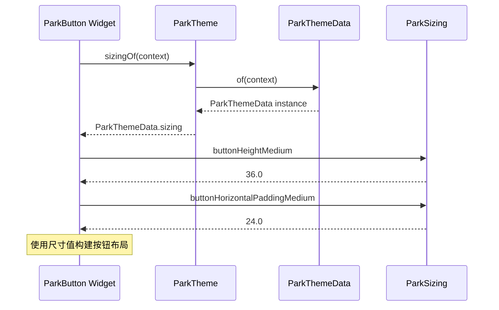
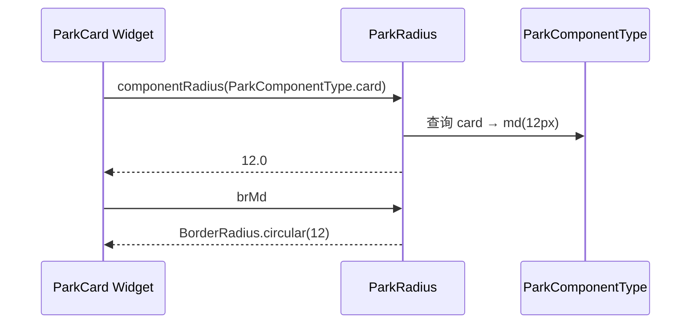
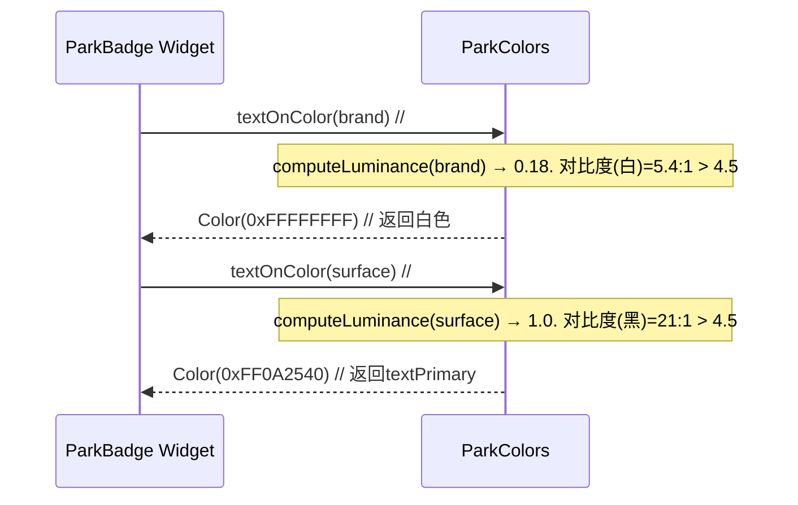
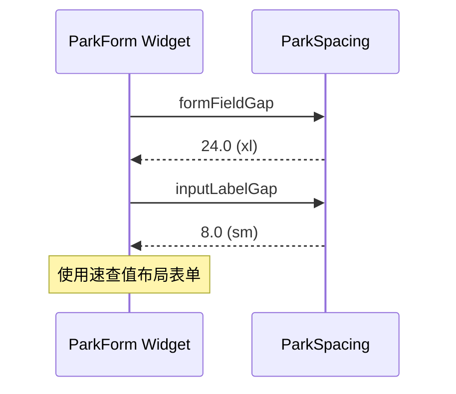
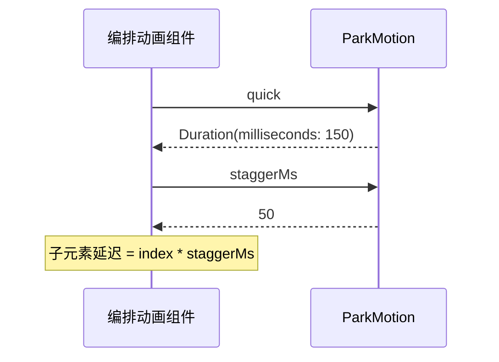
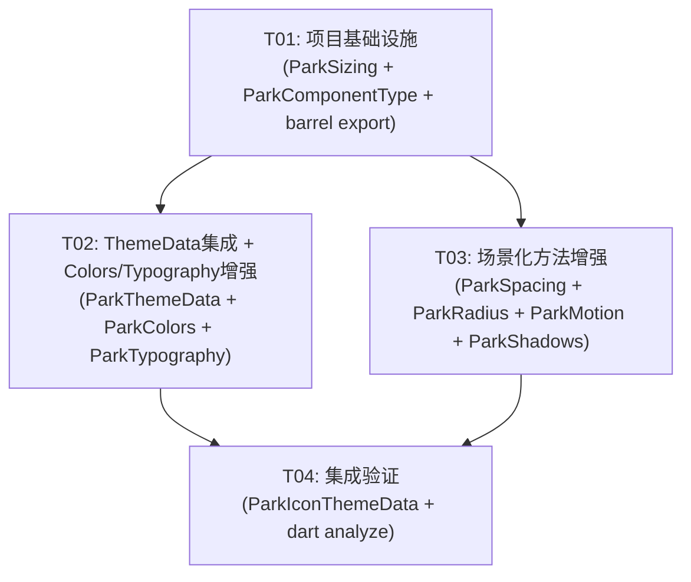

# Park UI 设计令牌系统 — 增量增强方案

> **作者**: 架构师（高见远）
> **阶段**: 增量设计分析（基于 DESIGN_SYSTEM_HANDOFF.md + 现有代码实现）
> **目标受众**: 工程师（寇豆码）
> **版本**: 1.1.0

---

## Part A: 系统设计

---

### 1. 实现方案

#### 1.1 核心难点分析

| 难点 | 说明 | 解决思路 |
|------|------|----------|
| 设计规约覆盖不足 | 手写设计§3.3/§3.4/§3.6/§5 定义的场景速查、组件圆角映射、组件尺寸等，当前令牌类均未暴露 | 在每个令牌类中添加领域语义方法，而非新设施 |
| 对比度计算 | WCAG AA 要求 `textOnColor()` 自动选择黑/白文字 | 使用 Flutter 内置 `Color.computeLuminance()` + W3C 公式计算对比度 |
| 组件尺寸标准化 | Button/Input 高度分散在各组件中，无统一来源 | 新增 `ParkSizing` 令牌类统一暴露 |
| 相等性判断 | 6 个令牌类均无 `==` / `hashCode`，导致状态比较/主题切换异常 | 沿用 Flutter `@immutable` 惯例，手写 `==` / `hashCode`（不需要引入 equatable 包） |

#### 1.2 框架选择

所有增强均使用 **纯 Dart/Flutter SDK**，不引入任何第三方依赖：

| 领域 | 方案 | 原因 |
|------|------|------|
| UI 框架 | Flutter SDK (Material) | 现有基线，不改动 |
| 色彩计算 | `Color.computeLuminance()` + 自定义 `contrastRatio()` | W3C WCAG 2.1 标准公式 |
| 相等性 | 手写 `operator ==` + `hashCode` | 仅 6-7 个类，手写比引入 equatable 更轻量 |
| 枚举类型 | 新增 `ParkComponentType` 枚举 | 组件映射的轻量级联合类型 |

#### 1.3 架构模式

- **现有模式**: 不可变值对象（`@immutable` class + `copyWith`）
- **增强方向**: 在值对象上增加**领域查询方法**（如 `componentRadius()`、`textOnColor()`）
- **无状态变更**: 所有新增方法都是纯查询/计算，不修改对象状态

---

### 2. 文件列表

所有路径相对于 `packages/park_ui/lib/`：

| # | 文件路径 | 操作 | 说明 |
|---|---------|------|------|
| 1 | `pubspec.yaml` | 修改 | 版本号 → 1.1.0 |
| 2 | `park_ui.dart` | 修改 | 增加 ParkSizing、ParkComponentType、ParkComponent 导出 |
| 3 | `src/theme/tokens/park_sizing.dart` | **新建** | 组件尺寸令牌类 |
| 4 | `src/theme/tokens/park_component_type.dart` | **新建** | 组件类型枚举（供 radius/spacing 映射使用） |
| 5 | `src/theme/tokens/park_colors.dart` | 修改 | 增加 textOnColor()、contrastRatio()、hashCode/== |
| 6 | `src/theme/tokens/park_typography.dart` | 修改 | 增加 letterSpacingOverline 字段、weightLight(w300)、hashCode/== |
| 7 | `src/theme/tokens/park_spacing.dart` | 修改 | 增加场景速查 getter、hashCode/== |
| 8 | `src/theme/tokens/park_radius.dart` | 修改 | 增加 componentRadius() 方法、hashCode/== |
| 9 | `src/theme/tokens/park_shadows.dart` | 修改 | 增加 hashCode/== |
| 10 | `src/theme/tokens/park_motion.dart` | 修改 | 增加 staggerMs 字段、hashCode/== |
| 11 | `src/theme/park_theme_data.dart` | 修改 | 增加 sizing 字段、copyWith/lerp/factory 更新、hashCode/== |
| 12 | `src/theme/park_theme.dart` | 修改 | 增加 `sizingOf()` 静态方法 + context extension |

**共 12 个文件**：2 个新建、10 个修改。

---

### 3. 数据结构和接口设计

```mermaid
classDiagram

    %% ========================================================================
    %% 新建类
    %% ========================================================================

    class ParkSizing {
        <<new>>
        +double buttonHeightSmall
        +double buttonHeightMedium
        +double buttonHeightLarge
        +double inputHeightSmall
        +double inputHeightMedium
        +double inputHeightLarge
        +double buttonHorizontalPaddingMedium
        +double buttonVerticalPaddingMedium
        +const ParkSizing(...)
        +factory ParkSizing.defaults()
        +ParkSizing copyWith(...)
        +bool operator ==(Object other)
        +int get hashCode
    }

    class ParkComponentType {
        <<enum>>
        +button
        +buttonRound
        +input
        +card
        +dialog
        +select
        +tagBadge
    }

    %% ========================================================================
    %% 增强类（标注 → 标记新增方法）
    %% ========================================================================

    class ParkColors {
        <<enhanced>>
        +Color brand
        +Color brandLight
        +Color brandDark
        +List~Color~ brandPalette
        +Color success
        +Color successLight
        +Color warning
        +Color warningLight
        +Color error
        +Color errorLight
        +Color info
        +Color infoLight
        +Color textPrimary
        +Color textSecondary
        +Color textPlaceholder
        +Color textDisabled
        +Color textOnBrand
        +Color border
        +Color borderLight
        +Color divider
        +Color background
        +Color surface
        +Color overlay
        +Color disabledBg
        +const ParkColors(...)
        +factory ParkColors.light()
        +factory ParkColors.dark()
        +Color brandAt(int level)
        +Color textOnColor(Color bg)           %% NEW
        +static double contrastRatio(Color a, Color b)  %% NEW
        +ParkColors copyWith(...)
        +bool operator ==(Object other)        %% NEW
        +int get hashCode                       %% NEW
    }

    class ParkTypography {
        <<enhanced>>
        +double sizeDisplay
        +double sizeH1
        +double sizeH2
        +double sizeH3
        +double sizeBody
        +double sizeBodySmall
        +double sizeCaption
        +double sizeOverline
        +double lineHeightTitle
        +double lineHeightBody
        +FontWeight weightBold
        +FontWeight weightRegular
        +FontWeight weightMedium
        +FontWeight weightLight                  %% NEW (w300)
        +String? fontFamily
        +double letterSpacingOverline           %% NEW
        +const ParkTypography(...)
        +factory ParkTypography.defaults()
        +TextStyle get display
        +TextStyle get h1
        +TextStyle get h2
        +TextStyle get h3
        +TextStyle get body
        +TextStyle get bodySmall
        +TextStyle get caption
        +TextStyle get overline                  %% MODIFIED (uses letterSpacingOverline)
        +ParkTypography copyWith(...)
        +bool operator ==(Object other)         %% NEW
        +int get hashCode                        %% NEW
    }

    class ParkSpacing {
        <<enhanced>>
        +double xxs, xs, sm, md, base, lg, xl, xxl, page
        +const ParkSpacing(...)
        +factory ParkSpacing.defaults()
        +Widget hGap(double)
        +Widget vGap(double)
        +Widget get hXs, hSm, hBase, hMd, hLg
        +Widget get vXs, vSm, vBase, vMd, vLg, vXl
        %% NEW scenario getters:
        +double get buttonHorizontalPadding     %% base + sm = 24px
        +double get buttonVerticalPadding       %% sm = 8px
        +double get inputLabelGap               %% sm = 8px
        +double get formFieldGap                %% xl = 24px
        +double get cardPadding                 %% base = 16px
        +double get cardGap                     %% xl = 24px
        +double get sectionGap                  %% xxl = 32px
        +double get dialogPadding               %% xl = 24px
        +ParkSpacing copyWith(...)
        +bool operator ==(Object other)         %% NEW
        +int get hashCode                        %% NEW
    }

    class ParkRadius {
        <<enhanced>>
        +double xs, sm, md, lg, xl, full
        +const ParkRadius(...)
        +factory ParkRadius.defaults()
        +BorderRadius get brXs, brSm, brMd, brLg, brXl, brFull
        +double componentRadius(ParkComponentType type)  %% NEW
        +ParkRadius copyWith(...)
        +bool operator ==(Object other)         %% NEW
        +int get hashCode                        %% NEW
    }

    class ParkShadows {
        <<enhanced>>
        +List~BoxShadow~ sm, md, lg
        +factory ParkShadows.defaults()
        +factory ParkShadows.dark()
        +factory ParkShadows.flat()
        +factory ParkShadows.neon()
        +ParkShadows copyWith(...)
        +bool operator ==(Object other)         %% NEW
        +int get hashCode                        %% NEW
    }

    class ParkMotion {
        <<enhanced>>
        +int standardMs
        +int quickMs
        +int slowMs
        +int staggerMs                           %% NEW
        +Curve enterEasing
        +Curve defaultEasing
        +Curve exitEasing
        +const ParkMotion(...)
        +Duration get standard, quick, slow
        +bool operator ==(Object other)         %% NEW
        +int get hashCode                        %% NEW
    }

    class ParkThemeData {
        <<enhanced>>
        +ParkColors colors
        +ParkTypography typography
        +ParkSpacing spacing
        +ParkRadius radius
        +ParkShadows shadows
        +ParkSurfaceStyle surfaceStyle
        +ParkIconThemeData iconTheme
        +ParkMotion motion
        +ParkSizing sizing                       %% NEW
        +const ParkThemeData(...)
        +factory ParkThemeData.light()           %% MODIFIED
        +factory ParkThemeData.dark()            %% MODIFIED
        +ParkThemeData copyWith(...)             %% MODIFIED
        +ParkThemeData lerp(...)                 %% MODIFIED
        +bool operator ==(Object other)         %% NEW
        +int get hashCode                        %% NEW
    }

    class ParkTheme {
        <<enhanced>>
        +ParkThemeData of(BuildContext)
        +ParkColors colorsOf(BuildContext)
        +ParkTypography typographyOf(BuildContext)
        +ParkSpacing spacingOf(BuildContext)
        +ParkRadius radiusOf(BuildContext)
        +ParkShadows shadowsOf(BuildContext)
        +ParkSizing sizingOf(BuildContext)        %% NEW
    }

    %% ========================================================================
    %% 关系
    %% ========================================================================

    ParkThemeData *-- ParkColors : contains
    ParkThemeData *-- ParkTypography : contains
    ParkThemeData *-- ParkSpacing : contains
    ParkThemeData *-- ParkRadius : contains
    ParkThemeData *-- ParkShadows : contains
    ParkThemeData *-- ParkMotion : contains
    ParkThemeData *-- ParkSizing : contains    %% NEW
    ParkRadius ..> ParkComponentType : uses
    ParkTheme ..> ParkThemeData : wraps
```



---

### 4. 程序调用流

#### 4.1 组件消费组件尺寸令牌



#### 4.2 组件查询圆角映射



#### 4.3 自动文字颜色选择



#### 4.4 场景速查间距消费



#### 4.5 编排动画使用 staggerMs



---

### 5. 不确定性 & 假设

| 不确定性 | 假设/决策 |
|----------|----------|
| `staggerMs` 默认值 | 设为 50ms（标准编排间隔），可配置 |
| `weightLight` w300 的用途 | 用于大字号展示（Display）的轻量字重变体 |
| `textOnColor()` 阈值 | 使用 W3C 标准阈值 4.5:1（AA normal text）；背景亮度使用 `computeLuminance()`，选择白/黑中对比度更高的 |
| `componentRadius()` 返回 double 而非 BorderRadius | 返回原始 double 值，调用方自行决定是否包装为 BorderRadius（复用已存在的 brSm 等 getter） |
| `ParkComponentType` 枚举位置 | 独立文件 `park_component_type.dart`（被 ParkRadius 和未来组件共同引用，避免循环依赖） |
| ParkSizing 按钮水平内边距 | 只提供 medium 尺寸的默认值（24px），small/large 由组件自行计算缩放 |
| 未变更的类 | ParkIconThemeData 非本次增量范围，但建议也补上 hashCode/==（放在 T04 中一并处理） |

---

## Part B: 任务分解

---

### 6. 所需依赖

```yaml
# 不引入任何新的第三方依赖
# 所有增强均使用 Flutter SDK 内置能力：
# - dart:ui (Color.computeLuminance)
# - package:flutter/material.dart (BorderRadius, BoxShadow, etc.)
# - dart:math (pow 用于对比度计算)
```

**pubspec.yaml 变更**：仅版本号从 `1.0.0` 升为 `1.1.0`

---

### 7. 任务列表（有序，按依赖排列）

#### T01：项目基础设施 — 新文件创建 + 导出配置

| 字段 | 值 |
|------|-----|
| **Task ID** | T01 |
| **Task Name** | 创建 ParkSizing 和 ParkComponentType 新文件 + 更新 barrel 导出 |
| **Priority** | P0 |
| **Dependencies** | 无（起点任务） |
| **Source Files** | 新建 2 个 + 修改 2 个 |

**文件操作明细**：

1. **新建** `src/theme/tokens/park_sizing.dart`
   - 定义 `ParkSizing` 类（`@immutable`）
   - 字段：buttonHeightSmall(28.0), buttonHeightMedium(36.0), buttonHeightLarge(44.0), inputHeightSmall(32.0), inputHeightMedium(48.0), inputHeightLarge(56.0), buttonHorizontalPaddingMedium(24.0), buttonVerticalPaddingMedium(8.0)
   - `const` 构造函数 + `ParkSizing.defaults()` 工厂
   - `copyWith()` 方法
   - `operator ==` / `hashCode`

2. **新建** `src/theme/tokens/park_component_type.dart`
   - 定义 `ParkComponentType` 枚举
   - 值：button, buttonRound, input, card, dialog, select, tagBadge

3. **修改** `park_ui.dart`
   - 增加导出：`export 'src/theme/tokens/park_sizing.dart';`
   - 增加导出：`export 'src/theme/tokens/park_component_type.dart';`

4. **修改** `pubspec.yaml`
   - 版本号从 `1.0.0` → `1.1.0`

---

#### T02：ParkThemeData 集成 + ParkColors/ParkTypography 增强

| 字段 | 值 |
|------|-----|
| **Task ID** | T02 |
| **Task Name** | ParkThemeData 集成 sizing + ParkColors 和 ParkTypography 增强 |
| **Priority** | P0 |
| **Dependencies** | T01 |
| **Source Files** | 修改 4 个 |

**文件操作明细**：

1. **修改** `src/theme/park_theme_data.dart`
   - import `park_sizing.dart`
   - 新增字段：`final ParkSizing sizing;`
   - 更新 `const ParkThemeData({..., this.sizing = const ParkSizing(), ...})`
   - 更新 `ParkThemeData.light()`：添加 `sizing: const ParkSizing()`
   - 更新 `ParkThemeData.dark()`：添加 `sizing: const ParkSizing()`
   - 更新 `copyWith()`：增加 `ParkSizing? sizing` 参数
   - 更新 `lerp()`：增加 `sizing: t < 0.5 ? sizing : other.sizing`
   - 新增 `operator ==` / `hashCode`

2. **修改** `src/theme/park_theme.dart`
   - 新增静态方法：`static ParkSizing sizingOf(BuildContext context) { return of(context).sizing; }`
   - 更新 `ParkThemeContextExtension`：新增 `ParkSizing get parkSizing => ParkTheme.sizingOf(this);`

3. **修改** `src/theme/tokens/park_colors.dart`
   - 新增方法：`Color textOnColor(Color bg)`
     - 计算 `bg` 与白色、`textPrimary` 的对比度，返回对比度更高的
   - 新增静态方法：`static double contrastRatio(Color a, Color b)`
     - 实现 W3C 公式：`(L1 + 0.05) / (L2 + 0.05)`，其中 L = relative luminance
   - 新增 `operator ==` / `hashCode`（比较所有 23 个 Color 字段 + brandPalette 列表）

4. **修改** `src/theme/tokens/park_typography.dart`
   - 新增字段：`final double letterSpacingOverline;`（默认值 0.5）
   - 新增字段：`final FontWeight weightLight;`（默认值 `FontWeight.w300`）
   - 更新 `const` 构造函数：加入两个新字段
   - 更新 `overline` getter：使用 `letterSpacing: letterSpacingOverline` 替换硬编码 `0.5`
   - 更新 `copyWith()`：加入两个新字段
   - 新增 `operator ==` / `hashCode`

---

#### T03：场景化方法增强 + 剩余令牌增强

| 字段 | 值 |
|------|-----|
| **Task ID** | T03 |
| **Task Name** | ParkSpacing 场景速查 + ParkRadius 组件映射 + ParkMotion stagger + ParkShadows |
| **Priority** | P1 |
| **Dependencies** | T01 |
| **Source Files** | 修改 4 个 |

**文件操作明细**：

1. **修改** `src/theme/tokens/park_spacing.dart`
   - 新增场景速查 getter 属性（全部是组合计算，非独立字段）：
     - `double get buttonHorizontalPadding => base + sm;` (24px)
     - `double get buttonVerticalPadding => sm;` (8px)
     - `double get inputLabelGap => sm;` (8px)
     - `double get formFieldGap => xl;` (24px)
     - `double get cardPadding => base;` (16px)
     - `double get cardGap => xl;` (24px)
     - `double get sectionGap => xxl;` (32px)
     - `double get dialogPadding => xl;` (24px)
   - 新增 `operator ==` / `hashCode`（比较 9 个 double 字段）

2. **修改** `src/theme/tokens/park_radius.dart`
   - import `park_component_type.dart`
   - 新增方法：`double componentRadius(ParkComponentType type)`
     - 实现 switch 映射：button→sm(8), buttonRound→full(9999), input→sm(8), card→md(12), dialog→lg(16), select→sm(8), tagBadge→xs(4)
   - 新增 `operator ==` / `hashCode`（比较 6 个 double 字段）

3. **修改** `src/theme/tokens/park_motion.dart`
   - 新增字段：`final int staggerMs;`（默认值 50）
   - 更新 `const ParkMotion` 构造函数
   - 新增 `operator ==` / `hashCode`

4. **修改** `src/theme/tokens/park_shadows.dart`
   - 新增 `operator ==` / `hashCode`（比较 3 个 `List<BoxShadow>` 字段——按 list + 各 shadow 属性深度比较）

---

#### T04：集成验证 + 最终检查

| 字段 | 值 |
|------|-----|
| **Task ID** | T04 |
| **Task Name** | 全量集成验证 + ParkIconThemeData hashCode/== |
| **Priority** | P2 |
| **Dependencies** | T02, T03 |
| **Source Files** | 检查/修改 2 个 |

**文件操作明细**：

1. **修改** `src/theme/park_icon_theme_data.dart`
   - 新增 `operator ==` / `hashCode`（补齐遗漏）

2. **验证** `park_ui.dart`
   - 确认所有新类已正确导出：
     - `ParkSizing`
     - `ParkComponentType`
   - 确认无重复/冲突导出

3. **运行静态分析**：
   - `dart analyze` 无错误
   - 确认所有 `copyWith` 方法签名完整
   - 确认无 `unused_import` / `unused_field` 警告

---

### 8. 共享知识

1. **`==` / `hashCode` 实现规范**
   - 所有令牌类使用同一模板：`runtimeType + all fields`
   - 集合类型（`List<Color>`）使用 `DeepCollectionEquality().equals()` 而非引用比较
   - `BoxShadow` 列表使用逐字段比较（color, blurRadius, spreadRadius, offset）

2. **`textOnColor()` 行为约定**
   - 输入：任意 `Color`
   - 输出：返回 `Colors.white`（如果对比度 > 4.5:1）或 `textPrimary`（否则）
   - 当背景为品牌色时，应直接返回 `textOnBrand` 而非计算（性能优化）
   - 公式：`relativeLuminance(color) = 0.2126 * R_lin + 0.7152 * G_lin + 0.0722 * B_lin`
   - 其中 `C_lin = (C_srgb / 255.0 <= 0.04045) ? C_srgb / 255.0 / 12.92 : pow((C_srgb / 255.0 + 0.055) / 1.055, 2.4)`
   - 对比度 = `(L1 + 0.05) / (L2 + 0.05)`（L1 为较亮值）

3. **ParkSizing 默认值映射表**

| 令牌 | 默认值 | 对应设计规约 |
|------|--------|-------------|
| buttonHeightSmall | 28.0 | §5 - Button 高度 small |
| buttonHeightMedium | 36.0 | §5 - Button 高度 medium |
| buttonHeightLarge | 44.0 | §5 - Button 高度 large |
| inputHeightSmall | 32.0 | §5 - Input 高度 small |
| inputHeightMedium | 48.0 | §5 - Input 高度 medium |
| inputHeightLarge | 56.0 | §5 - Input 高度 large |
| buttonHorizontalPaddingMedium | 24.0 | §3.3 按钮水平内边距(medium) |
| buttonVerticalPaddingMedium | 8.0 | §3.3 按钮垂直内边距(medium) |

4. **场景速查依赖关系**

| 速查 getter | 依赖的基令牌 | 结果值 |
|-------------|-------------|--------|
| buttonHorizontalPadding | base + sm | 16+8=24 |
| buttonVerticalPadding | sm | 8 |
| inputLabelGap | sm | 8 |
| formFieldGap | xl | 24 |
| cardPadding | base | 16 |
| cardGap | xl | 24 |
| sectionGap | xxl | 32 |
| dialogPadding | xl | 24 |

5. **组件圆角映射表**

| ParkComponentType | 返回值 | 对应半径令牌 |
|-------------------|--------|-------------|
| button | 8.0 | sm |
| buttonRound | 9999.0 | full |
| input | 8.0 | sm |
| card | 12.0 | md |
| dialog | 16.0 | lg |
| select | 8.0 | sm |
| tagBadge | 4.0 | xs |

6. **API 响应/异常约定**
   - 所有令牌构造参数有默认值，消费者可以只传入需要覆盖的字段
   - `copyWith()` 中 `null` 表示"不覆盖"，而非"设为 null"
   - 需要将字段设为 null 的类应提供独立 setter，或使用 `Optional<T>` 包装（当前范围无此需求）

---

### 9. 任务依赖关系图



**依赖说明**：

- T01 是绝对起点：必须先创建 `ParkSizing` 和 `ParkComponentType` 文件，其他的才能 import
- T02 依赖 T01：需要 `ParkSizing` 类才能在 `ParkThemeData` 中声明字段
- T03 依赖 T01：需要 `ParkComponentType` 枚举才能在 `ParkRadius.componentRadius()` 中使用
- T04 依赖 T02+T03：必须在所有修改完成后运行全量静态分析验证

**并行可能性**：T02 和 T03 互不依赖，可以在 T01 完成后并行实现。但建议工程师按 T01 → T02 → T03 → T04 顺序执行以减少上下文切换。

---

*本文档由架构师（高见远）生成，供工程师（寇豆码）执行。*
